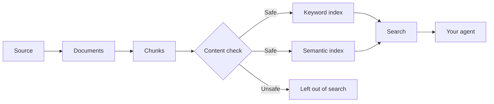

import PrivateBeta from './_snippets/private-beta.mdx'

<PrivateBeta />

Business Knowledge turns your sources into small passages an agent can search. This page explains each stage, so you know what an agent can find, when it can find it, and why.

## From a source to chunks

A source holds one or more documents. A text source and a file source hold one document each. A URL source holds one document for each page it indexes.

PostHog splits each document into chunks. A chunk is a passage of about 1,200 characters, cut at paragraph breaks where possible, with a hard limit of 1,600 characters. Chunks don't overlap. Search returns chunks, not whole documents.

| Source type | How PostHog reads it |
| --- | --- |
| Text | Uses the text as you pasted it |
| URL | Fetches each page and keeps the main content, without navigation and footers |
| PDF | Reads the text of each page. A scanned PDF with no text layer can't be read. |
| DOCX | Keeps headings and table rows |
| CSV | Turns each row into `column: value` lines |
| Markdown and plain text | Uses the text as it is |

## The content check

Before search can use a document, PostHog checks it for text that tries to take control of an agent. Examples are hidden instructions to ignore the agent's rules, to leak data, or to mislead the person who asked. Ordinary business content passes.

- The check runs about once an hour
- It runs only after your organization [approves AI data processing](/docs/business-knowledge/ai-data-processing)
- A document marked unsafe stays listed on the source and is left out of every search
- A document that hasn't been checked yet is also left out

When you edit a source or a refresh finds changed content, the changed document is checked again.

## How search works

Each search runs two lookups and merges the results.

- **Keyword** – Matches the words in the query against the words in each chunk. It's available as soon as a document passes the content check.
- **Semantic** – Matches by meaning, so "money back" finds a chunk about refunds. The semantic index builds in the background and can take up to an hour after the content check.

PostHog ranks the merged list, then adds the chunk before and the chunk after each match, so a result comes with its surrounding text. A search returns 10 chunks by default and 20 at most.

Each result says how it was found:

| `matched_by` | Meaning |
| --- | --- |
| `keyword` | The keyword lookup found it |
| `semantic` | The semantic lookup found it |
| `both` | Both lookups found it |
| `context` | It's next to a match and was added for context |

A search can also rerank its results with a model for better relevance. Reranking is on by default for MCP tools and off by default for the [REST API](/docs/business-knowledge/connect-your-agent#call-the-rest-api). If the reranking step fails, the search returns the merged order.

Search reads a source that shows **ready** or **indexing**. An **indexing** source is found by keyword only. See [source status](/docs/business-knowledge/sources#source-status).

## Reading around a result

One chunk is often not enough to answer a question. An agent can ask for the chunks around a result in the same document, up to 15 on each side.

## Guidance in every reply

A source with [**Always include in replies**](/docs/business-knowledge/sources#always-include-in-replies) on gets one more use. PostHog adds its text to every Support reply and Playground answer, whatever the question, up to 20,000 characters across all such sources. Search still finds the source like any other, including searches by your own agents. Use the setting for tone and policy, and leave it off for facts an agent can search for.

## GitHub repositories

[Repositories](/docs/business-knowledge/github) work differently from sources. PostHog doesn't index your code. It keeps a list of file paths and README text for each repository you select. A repository search matches file names, path fragments, and identifiers, then the agent reads the matching file from GitHub.

## Who searches

| Surface | How it uses Business Knowledge |
| --- | --- |
| [PostHog AI](/docs/business-knowledge/where-to-use#posthog-ai) | Searches when a question is about your product, policies, or team |
| [Support](/docs/business-knowledge/where-to-use#support) | Searches while the AI agent works on a ticket, and adds always-included guidance |
| [Your own agents](/docs/business-knowledge/connect-your-agent) | Search through the MCP server or the REST API, with a key that reads all your knowledge or one library |
| [Playground](/docs/business-knowledge/playground) | Shows the answer and the chunks behind it |

Each search counts toward [usage](/docs/business-knowledge/usage), whichever surface made it.
