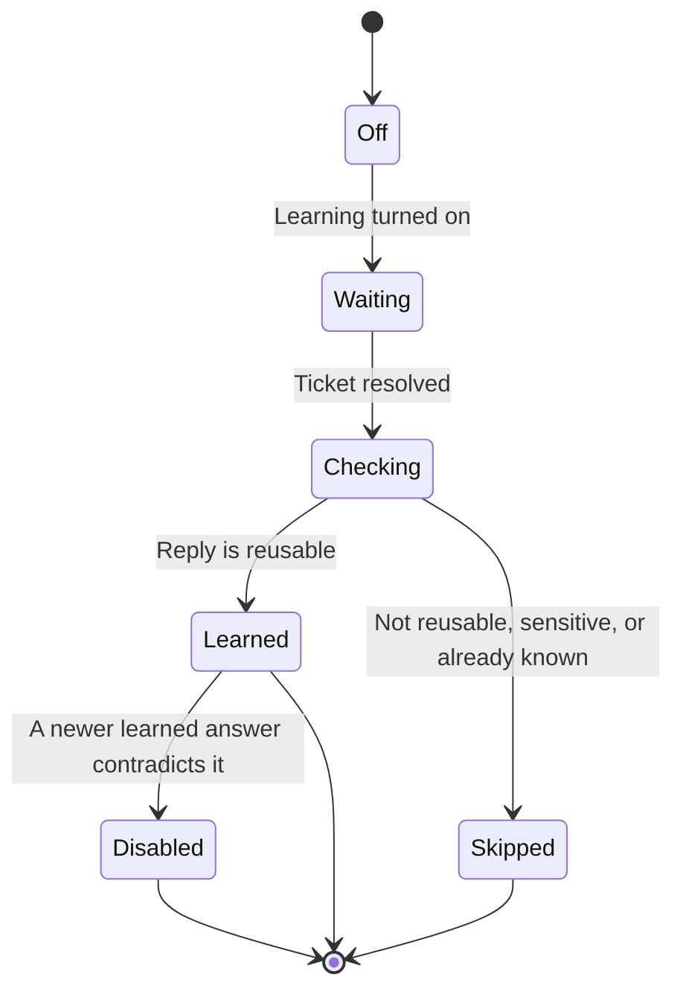

import PrivateBeta from './_snippets/private-beta.mdx'

<PrivateBeta />

When Learn from support is on, PostHog turns the replies your team writes on resolved support tickets into learned sources. The next time someone asks the same question, answers can reuse what your team already said.

## Enable learning

Learning is off by default, and it needs two things first:

- [Support](/docs/support/start-here) [turned on](https://app.posthog.com/support/settings) in the same environment, because learning reads resolved Support tickets. While Support is off, the switch stays disabled.
- [AI data processing](/docs/business-knowledge/requirements) approved for the organization, because a model analyzes each reply.

Then turn on **Learn from support** in [Business Knowledge settings](https://app.posthog.com/business-knowledge/settings). In project settings, the same switch is named **Self-learning**.

## How learning runs

Every five minutes, PostHog looks for resolved tickets. It waits until at least five minutes have passed since a ticket's last update or last public reply from a person, and it reads tickets from every environment where Support is on.

A public reply from a person is the only text PostHog learns from. It skips private notes, customer messages, deleted replies, and AI replies, so an internal note or an AI draft never becomes a source.

PostHog checks each reply for reusable information, personal data, secrets, and overlap with what Business Knowledge already holds. Each accepted answer becomes a learned source, named after its topic. You can open, edit, or delete a learned source like any other source. If PostHog analyzes the same ticket again, it doesn't change a source that already exists.

## When a new answer contradicts an old one

- **The old answer is a learned source:** PostHog keeps the newer answer and disables the old source. The old source keeps its content, shows **disabled**, and answers stop using it. The activity log records the change.
- **The old answer is a source that a person added:** PostHog keeps that source and discards the new answer. Only a person changes a source that a person wrote.

PostHog only disables a learned source that holds one document, because disabling a larger source would also hide its other documents. When the old source holds more than one document, PostHog discards the new answer.

## Find learned sources

On the sources list, filter by **Learned**. Each learned source links to the ticket it came from. In the Playground, answers mark this text as learned from support.

A project can have up to 10,000 learned sources, and they don't count toward the 500 sources you can add yourself. At 10,000, PostHog stops adding answers until you delete some.

## Turn learning off

Turn off **Learn from support** in [Business Knowledge settings](https://app.posthog.com/business-knowledge/settings) to stop new learning. Learned sources stay until you delete them.
