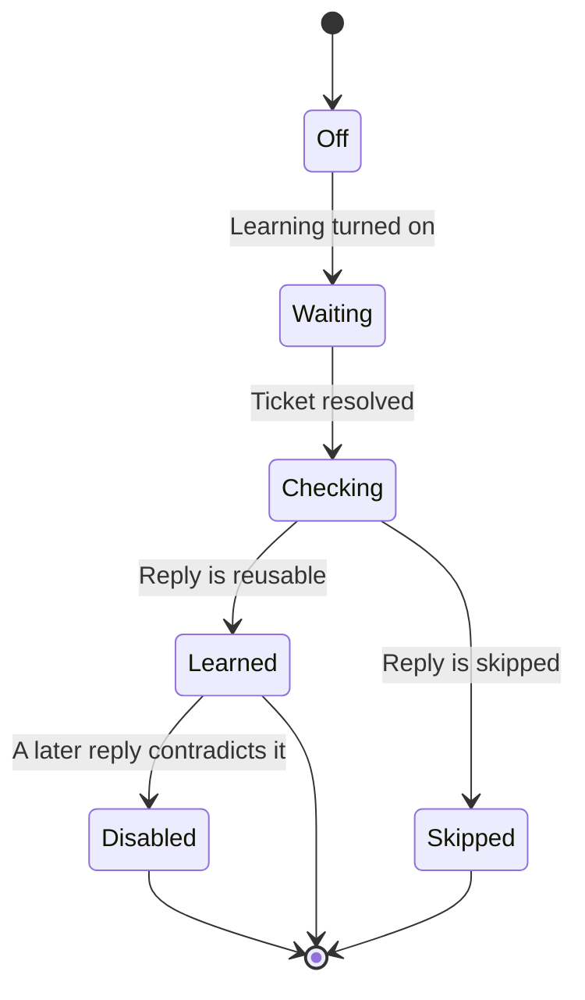

import PrivateBeta from './_snippets/private-beta.mdx'

<PrivateBeta />

Learn from support turns your team's replies to resolved [Support](/docs/support/start-here) tickets into reusable answers in Business Knowledge. It's off by default.

## Enable learning

Turn on **Self-learning** in [Business Knowledge settings](https://app.posthog.com/business-knowledge/settings). Two things have to be on first:

- [Support](https://app.posthog.com/support/settings), in the same environment. Until then, the switch is disabled.
- [AI data processing](/docs/business-knowledge/ai-data-processing), for the organization.

## How learning runs

PostHog checks for resolved tickets every five minutes. It learns only from public replies your team wrote. Private notes, customer messages, and AI replies are skipped, so an internal note or an AI draft never becomes a source.

Each reply is checked for reusable information, personal data, secrets, and overlap with what Business Knowledge already has. An accepted answer becomes its own learned source, named after the topic. You can open, edit, or delete it.

If a later reply contradicts a learned answer, the newer answer wins. The older one is disabled but kept, and the change shows in the activity log. If the newer answer contradicts a source you wrote, PostHog keeps your source and skips the answer.

To see learned sources, filter the sources list by **Learned**. Each row links to the ticket it came from. A project can hold up to 10,000 learned sources, and they don't count toward the 500 you add yourself.

## Turn learning off

Turn off **Self-learning** to stop learning new answers. Answers it already learned stay until you delete them.
