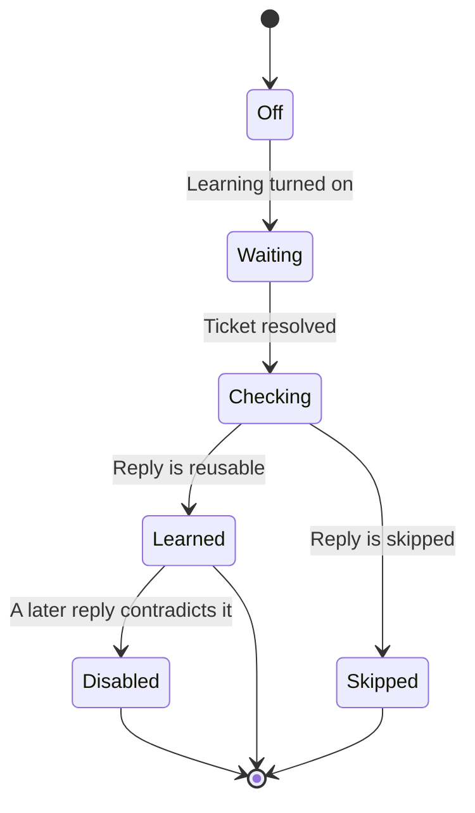

import PrivateBeta from './_snippets/private-beta.mdx'

<PrivateBeta />

Learn from support is a Business Knowledge setting. When it's on, PostHog learns reusable answers from resolved support tickets.

The setting is off by default. Turn it on in [Business Knowledge settings](https://app.posthog.com/business-knowledge/settings). The settings title there is **Self-learning**.

## Enable learning

Learning reads resolved [Support](/docs/support/start-here) tickets, so [turn Support on](https://app.posthog.com/support/settings) in the same environment before you enable learning.

If Support is off, the switch stays disabled and links to Support settings. You can still turn learning off if it was already on.

Learning also needs [AI data processing](/docs/business-knowledge/requirements) approved for the organization. If it's off, PostHog doesn't analyze resolved tickets.

## How learning runs

PostHog checks for resolved tickets every five minutes. It waits at least five minutes after the ticket is last updated or receives a public reply from a person. It reads those replies from each environment where Support is on.

A public reply from a person is the only text PostHog learns from. Private notes, customer messages, deleted replies, and AI replies are skipped, so an internal note or an AI draft never becomes a source.

PostHog checks each reply for reusable information, personal data, secrets, and overlap with existing Business Knowledge. It adds accepted answers as their own learned sources, named after the topic. You can open, edit, or delete a learned source. PostHog doesn't change a source that already exists when it analyzes the same ticket again.

If a later reply contradicts an earlier learned source, PostHog keeps the newer answer and disables the older learned source so it stops being used in replies. PostHog keeps the older source and its content, and records the change in the activity log. PostHog only replaces a learned source that holds one document, so a crawled site with many pages stays as it is. PostHog never disables a source you wrote this way. It keeps that source and skips the newer answer.

A project can have up to 10,000 learned sources. After that, PostHog doesn't add new answers until you delete some.

Learned sources don't count toward the 500 sources you add yourself. On the sources list, filter **Learned** to see them. A learned row links to the ticket it came from. In the Playground, that text is labeled as learned from support.

## Turn learning off

Turn off Learn from support in [Business Knowledge settings](https://app.posthog.com/business-knowledge/settings) to stop new analysis. Sources already learned stay in Business Knowledge until you delete them. Open a learned source and delete it to remove that answer.
