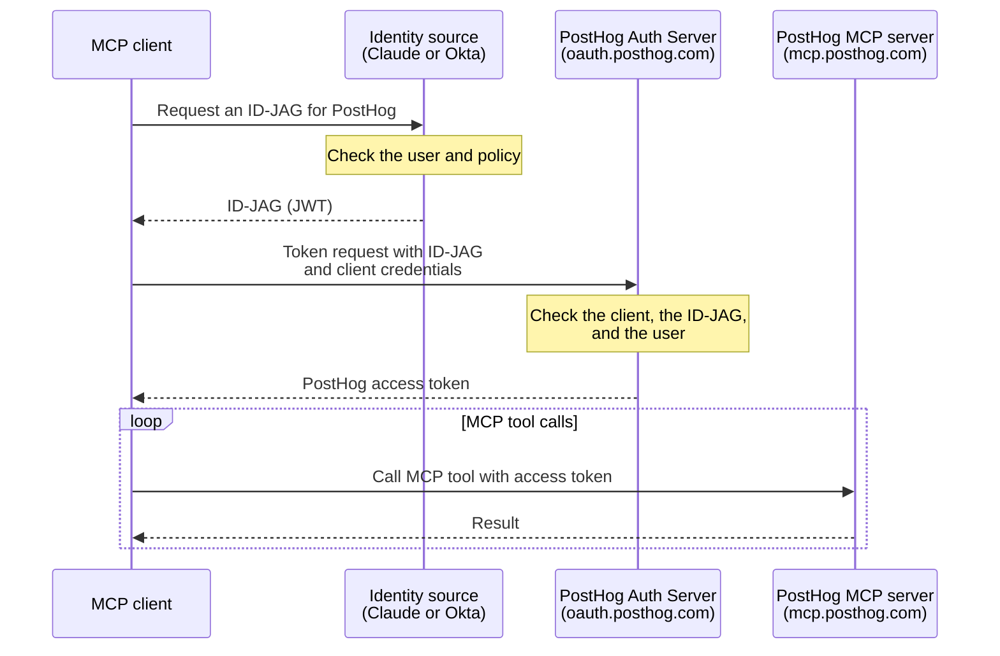

import { CalloutBox } from 'components/Docs/CalloutBox'

The PostHog MCP server supports the [Model Context Protocol Enterprise-Managed Authorization extension](https://modelcontextprotocol.io/extensions/auth/enterprise-managed-authorization). An organization admin connects PostHog to an AI client such as Claude once, and members get access automatically when they sign in. Nobody has to OAuth to PostHog individually or manage a [personal API key](/docs/model-context-protocol/faq#using-an-api-key-instead-of-oauth).

It's built on [ID-JAG (XAA)](/docs/settings/authentication/id-jag): an identity source vouches for the signed-in user, and the MCP client exchanges that assertion with PostHog for a short-lived access token.

<CalloutBox icon="IconStar" title="Scale and Enterprise add-ons" type="action">

Enterprise-managed authorization is available to organizations on the Scale or Enterprise [platform add-on](/platform-packages). Without one of them, PostHog shows an upgrade prompt in the XAA settings and rejects token requests with `access_denied`.

</CalloutBox>

> **Who is this for?** Teams that want MCP access to follow central policy. If you're an individual user, the standard [OAuth flow](/docs/model-context-protocol) is simpler and works out of the box.

## Choose an identity source

Claude supports two identity sources for PostHog. Pick the one that matches how your organization signs in to Claude:

| | [Claude-issued identity](/docs/model-context-protocol/claude-issued-identity) | [Okta Cross App Access](/docs/model-context-protocol/okta-cross-app-access) |
| --- | --- | --- |
| **Who vouches for the user** | Claude, under an issuer URL unique to your Claude organization | Your Okta org |
| **What you need** | Claude Team or Enterprise. No identity provider or SSO | Okta with Cross App Access, and Claude sign-in through Okta |
| **Where access is controlled** | Claude roles, and PostHog membership | Okta assignments and scopes, and PostHog membership |
| **Setup effort** | A few minutes, in Claude and PostHog | Longer, in Okta, Claude, and PostHog |

Claude-issued identity isn't available in a Claude organization that signs in through Okta. Use Okta Cross App Access there.

## What every setup needs

- The **Scale or Enterprise platform add-on** on your PostHog organization.
- A **verified domain** in PostHog for your users' email domain.
- Users who are **already members** of your PostHog organization, with the same email they use in Claude. PostHog does not create accounts from ID-JAGs.
- These scopes, at minimum: `user:read`, `organization:read`, and `project:read`. The MCP server needs them to list your organizations and projects. Add scopes for the tools you want to use.

The MCP server URLs are `https://mcp.posthog.com/mcp`, and `https://mcp-eu.posthog.com/mcp` to pin the EU region.

## How it works

Your users never see a PostHog authorization prompt. For what PostHog checks, how it matches users, token details, and every error code, see the [ID-JAG reference](/docs/settings/authentication/id-jag).

## Further reading

- [ID-JAG (XAA) authentication](/docs/settings/authentication/id-jag) – the reference for the PostHog side
- [Claude: auto-connect your organization's apps](https://support.claude.com/en/articles/15537633-auto-connect-your-organization-s-apps-to-claude)
- [MCP Enterprise-Managed Authorization extension](https://modelcontextprotocol.io/extensions/auth/enterprise-managed-authorization)
- [MCP server overview](/docs/model-context-protocol)
- [MCP FAQ and advanced setup](/docs/model-context-protocol/faq)
