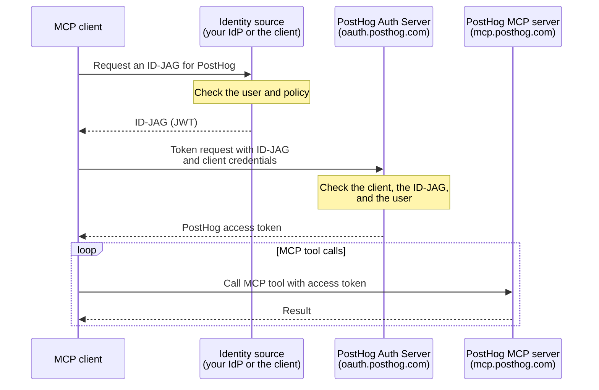

import { CalloutBox } from 'components/Docs/CalloutBox'

The PostHog MCP server supports the [Model Context Protocol Enterprise-Managed Authorization extension](https://modelcontextprotocol.io/extensions/auth/enterprise-managed-authorization). Any MCP client that supports the extension can use it. An organization admin connects PostHog to the client once, and members get access automatically when they sign in to the client. Nobody has to OAuth to PostHog individually or manage a [personal API key](/docs/model-context-protocol/faq#using-an-api-key-instead-of-oauth).

It's built on [ID-JAG (XAA)](/docs/settings/authentication/id-jag): an identity source vouches for the signed-in user, and the MCP client exchanges that assertion with PostHog for a short-lived access token.

<CalloutBox icon="IconStar" title="Scale and Enterprise add-ons" type="action">

Enterprise-managed authorization is available to organizations on the Scale or Enterprise [platform add-on](/platform-packages). Without one of them, PostHog shows an upgrade prompt in the XAA settings and rejects token requests with `access_denied`.

</CalloutBox>

> **Who is this for?** Teams that want MCP access to follow central policy. If you're an individual user, the standard [OAuth flow](/docs/model-context-protocol) is simpler and works out of the box.

## Client guides

- [Claude](/docs/model-context-protocol/claude-managed-authorization): Claude-issued identity, or IdP-issued identity through Okta.

For another client, follow its enterprise-managed authorization docs, together with [Set up PostHog](#set-up-posthog) and [Set up your MCP client](#set-up-your-mcp-client) on this page.

## Identity sources

The identity source signs an ID-JAG that tells PostHog who the signed-in user is. PostHog supports two kinds:

- **IdP-issued:** your identity provider, such as Okta, issues the ID-JAG. You control access with the assignments and scopes in your identity provider.
- **Client-issued:** the MCP client issues the ID-JAG itself, under an issuer URL that is unique to your organization in that client. You don't need an identity provider or SSO. Claude supports this as **Claude-issued** identity.

PostHog handles both kinds the same way. It trusts the issuer URL that you enter in your XAA configuration.

## What every setup needs

- The **Scale or Enterprise platform add-on** on your PostHog organization.
- A **verified domain** in PostHog for your users' email domain.
- Users who are **already members** of your PostHog organization, with the same email they use in the MCP client. PostHog does not create accounts from ID-JAGs.
- These scopes, at minimum: `user:read`, `organization:read`, and `project:read`. The MCP server needs them to list your organizations and projects. Add scopes for the tools you want to use. Start with the [recommended scopes](/docs/settings/authentication/id-jag#which-scopes-should-i-grant). [API scopes](/docs/api/scopes) explains what each one covers.

## Set up PostHog

1. Go to [**Organization settings → Authentication**](https://app.posthog.com/settings/organization-authentication). You need to be an organization admin.
2. Under **Authentication domains**, add and verify your email domain if it isn't verified yet. See the [SSO docs](/docs/settings/authentication/sso) for the steps.
3. Find **XAA authentication** and click **Configure**.
4. Set **Identity provider issuer URL** to the issuer of your identity source.
5. Under **Domains**, choose the domains your members use.
6. Click **Save configuration**.

You can leave **JWKS URL** and **Allowed client IDs** empty. PostHog finds the signing keys from the issuer URL. The [ID-JAG reference](/docs/settings/authentication/id-jag#2-configure-the-trusted-idp) explains each field.

### Automatic setup

A client that issues its own ID-JAGs can register its issuer URL for you, so you don't paste it. The client sends you to a PostHog consent screen, where an organization admin approves it. PostHog then creates a read-only XAA configuration for all of the organization's verified domains, tagged with the client's name. To stop trusting the client, delete that configuration.

Only clients that PostHog approves can request this, with the `ema_issuer:manage` scope. Claude is the first. See [Claude automatic setup](/docs/model-context-protocol/claude-managed-authorization#automatic-setup).

## Set up your MCP client

Your MCP client or identity provider asks for some of these values:

| Setting | Value |
| --- | --- |
| **MCP server URL** | `https://mcp.posthog.com/mcp`, or `https://mcp-eu.posthog.com/mcp` to pin the EU region |
| **Resource** | The MCP server URL |
| **Authorization server**, or the ID-JAG audience | `https://oauth.posthog.com` |
| **Scopes** | The [recommended scopes](/docs/settings/authentication/id-jag#which-scopes-should-i-grant), or the ones your members need |
| **Tenant ID** | Leave it empty. PostHog finds your organization from the issuer URL and the member's email domain. |

The client must also authenticate to PostHog with its own client ID. Most MCP clients that support enterprise-managed authorization do this for you. If you build your own client, see [how to exchange an ID-JAG yourself](/docs/settings/authentication/id-jag#how-do-i-exchange-an-id-jag-myself).

## How it works

Your users never see a PostHog authorization prompt. For what PostHog checks, how it matches users, token details, and every error code, see the [ID-JAG reference](/docs/settings/authentication/id-jag).

## Further reading

- [Connect Claude with enterprise-managed authorization](/docs/model-context-protocol/claude-managed-authorization)
- [ID-JAG (XAA) authentication](/docs/settings/authentication/id-jag) – the reference for the PostHog side
- [MCP Enterprise-Managed Authorization extension](https://modelcontextprotocol.io/extensions/auth/enterprise-managed-authorization)
- [MCP server overview](/docs/model-context-protocol)
- [MCP FAQ and advanced setup](/docs/model-context-protocol/faq)
