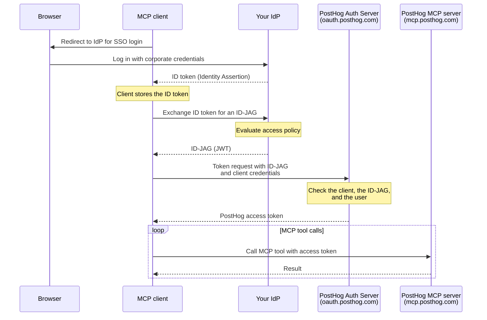

import { CalloutBox } from 'components/Docs/CalloutBox'

The PostHog MCP server supports the [Model Context Protocol Enterprise-Managed Authorization extension](https://modelcontextprotocol.io/extensions/auth/enterprise-managed-authorization). This lets your organization's identity provider (IdP), such as Okta, Microsoft Entra ID, or any OIDC-compliant SSO, control who can connect to the PostHog MCP server, without each employee individually OAuthing to PostHog or managing a [personal API key](/docs/model-context-protocol/faq#using-an-api-key-instead-of-oauth).

It's built on [ID-JAG (XAA)](/docs/settings/authentication/id-jag): your IdP issues a short-lived assertion that the MCP client exchanges with PostHog for an access token. You grant, scope, and revoke access centrally in your IdP.

<CalloutBox icon="IconStar" title="Scale and Enterprise add-ons" type="action">

Enterprise-managed authorization is available to organizations on the Scale or Enterprise [platform add-on](/platform-packages). Without one of them, PostHog shows an upgrade prompt in the XAA settings and rejects token requests with `access_denied`.

</CalloutBox>

> **Who is this for?** Teams that already manage app access through an IdP and want MCP access to follow the same policies. If you're an individual user, the standard [OAuth flow](/docs/model-context-protocol) is simpler and works out of the box.

## How it works

Instead of sending the user to PostHog to authorize, the MCP client asks your IdP for an ID-JAG and exchanges it for a PostHog access token. Your IdP evaluates its own access policies (group membership, conditional access, etc.) before it issues the ID-JAG, so authorization decisions stay in one place.



Your users sign in with their normal corporate SSO and never see a PostHog authorization prompt.

## Requirements

- The **Scale or Enterprise platform add-on** on your PostHog organization.
- A **verified domain** in PostHog for the email domain your users sign in with.
- Users who are **already members** of your PostHog organization. PostHog does not create accounts from ID-JAGs, so provision users with [SCIM](/docs/settings/authentication/scim) or SSO first.
- An **IdP that can issue ID-JAGs** and publishes its signing keys where PostHog can reach them over the internet.
- An **MCP client that supports the enterprise-managed authorization extension**. Support is opt-in and varies by client, so check the [MCP client matrix](https://modelcontextprotocol.io/extensions/client-matrix).

## Setup

### 1. Verify your domain in PostHog

Go to [**Organization settings → Authentication**](https://app.posthog.com/settings/organization-authentication) and add and verify the domain your users authenticate with (e.g. `example.com`) under **Authentication domains**. See the [SSO docs](/docs/settings/authentication/sso) for domain verification steps.

### 2. Configure the trusted IdP

On the same settings page, find **XAA authentication** and click **Configure**. You need to be an organization admin. Fill in:

| Field | Required | Description |
| --- | --- | --- |
| **Identity provider issuer URL** | Yes | Your IdP's issuer URL, e.g. `https://idp.example.com`. Your IdP shows it in its OIDC or authorization server settings. |
| **JWKS URL (optional)** | No | Where PostHog fetches your IdP's public keys. Leave it empty unless your IdP publishes its keys somewhere other than its OIDC discovery document. |
| **Allowed client IDs (optional)** | No | Limits which MCP clients can use this IdP. Leave it empty to allow any registered client. |

Under **Domains**, choose **All domains** or **Selected domains**, then click **Save configuration**.

### 3. Grant the required scopes in your IdP

Configure your IdP to include these scopes when it issues ID-JAGs for PostHog:

- `user:read`, which every MCP connection needs.
- `organization:read` and `project:read`, which the MCP server needs to list your organizations and projects.
- Any additional scopes for the MCP tools you want to use (for example, `feature_flag:write` to manage flags).

The access token gets only the scopes that both your IdP granted and the client asked for. Without the first three scopes, the MCP server rejects requests with `insufficient_scope`.

### 4. Point your MCP client at PostHog

Follow your MCP client's instructions for enterprise-managed authorization, and use one of these server URLs:

- `https://mcp.posthog.com/mcp`
- `https://mcp-eu.posthog.com/mcp`, which pins the EU region

The client handles the ID-JAG exchange for you.

## Revoking access

- **At your IdP:** once your IdP stops issuing ID-JAGs for a user, or for PostHog, the client can no longer get new access tokens. Existing tokens expire within 2 hours.
- **In PostHog:** removing the user from the organization, or deactivating them, stops their tokens working on the next request.
- **The whole integration:** deleting the XAA configuration stops new tokens. Tokens already issued stay valid until they expire.

## Troubleshooting

The most common errors when an MCP client requests a token:

| Error | What to check |
| --- | --- |
| `access_denied` | Your organization doesn't have the Scale or Enterprise add-on. |
| `invalid_client` | The MCP client failed to authenticate to PostHog, or its client ID isn't in **Allowed client IDs**. |
| `invalid_grant` (`ID-JAG could not be verified`) | The issuer URL in your XAA configuration doesn't match your IdP, or the user's email domain isn't one of the configuration's verified domains. |
| `invalid_grant` (`ID-JAG sub is not an active member…`) | The user isn't a member of your PostHog organization yet. |
| `invalid_target` | The ID-JAG's `resource` isn't the MCP server URL the client connected to. |
| `insufficient_scope` (from the MCP server) | The token is missing `user:read`, `organization:read`, `project:read`, or a scope a tool needs. Add it in your IdP. |

For every error code, see the [ID-JAG error reference](/docs/settings/authentication/id-jag#what-do-all-the-error-codes-mean).

## FAQ

<details>
<summary id="how-does-an-mcp-client-discover-that-posthog-supports-this">How does an MCP client discover that PostHog supports this?</summary>

The MCP server's protected resource metadata (for example `https://mcp.posthog.com/.well-known/oauth-protected-resource/mcp`) names `https://oauth.posthog.com` as its authorization server. That server's RFC 8414 metadata at `https://oauth.posthog.com/.well-known/oauth-authorization-server` advertises the ID-JAG grant profile:

```json
{
  "authorization_grant_profiles_supported": [
    "urn:ietf:params:oauth:grant-profile:id-jag"
  ],
  "grant_types_supported": [
    "authorization_code",
    "refresh_token",
    "urn:ietf:params:oauth:grant-type:jwt-bearer"
  ]
}
```

The OIDC discovery document lists the `jwt-bearer` grant type but not `authorization_grant_profiles_supported`.

</details>

<details>
<summary id="what-goes-in-the-id-jag-for-the-mcp-server">What goes in the ID-JAG for the MCP server?</summary>

- `aud` is the authorization server issuer: `https://oauth.posthog.com`.
- `resource` is the `resource` value from the MCP server's protected resource metadata: `https://mcp.posthog.com/mcp`, or `https://mcp-eu.posthog.com/mcp` for the EU-pinned URL.
- `client_id` is the client ID the MCP client uses with PostHog. The client must also authenticate when it presents the ID-JAG, with a client secret or `private_key_jwt`.

See [what PostHog checks in an ID-JAG](/docs/settings/authentication/id-jag#what-does-posthog-check-in-an-id-jag) for every claim.

</details>

<details>
<summary id="what-can-the-access-token-do">What can the access token do?</summary>

- **It lasts 2 hours by default.** The client repeats the ID-JAG exchange to get a fresh token. There is no refresh token.
- **It acts as the matched user**, with that user's permissions, limited to the granted scopes.
- **It is bound to one organization:** the one that owns the XAA configuration.
- **Its `aud` is the MCP server URL.** PostHog accepts it only for its own resources, which include the PostHog API that the MCP server calls.
- **PostHog checks it on every request.** The user must still be an active member, and the organization must still have the Scale or Enterprise add-on.

</details>

## Further reading

- [ID-JAG (XAA) authentication](/docs/settings/authentication/id-jag) – the general grant, beyond MCP
- [MCP Enterprise-Managed Authorization extension](https://modelcontextprotocol.io/extensions/auth/enterprise-managed-authorization)
- [ID-JAG / XAA specification](https://xaa.dev)
- [MCP server overview](/docs/model-context-protocol)
- [MCP FAQ and advanced setup](/docs/model-context-protocol/faq)
- [SSO and authentication domains](/docs/settings/authentication/sso)
