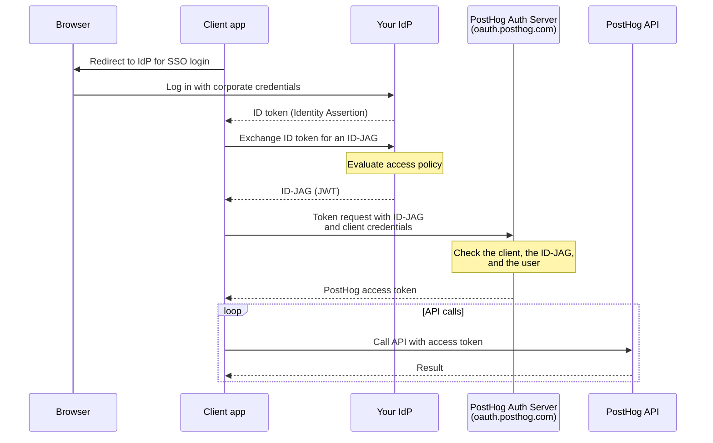

import { CalloutBox } from "components/Docs/CalloutBox";

ID-JAG (Identity Assertion JWT Authorization Grant, also called [XAA](https://xaa.dev)) lets your organization's identity provider (IdP), such as Okta, Microsoft Entra ID, or any OIDC-compliant SSO, grant programmatic access to PostHog. Instead of each user creating a [personal API key](/docs/api#authentication) or running an [OAuth](/docs/api/oauth) flow, your IdP issues an **ID-JAG** that a client exchanges with PostHog for a short-lived access token. You grant, scope, and revoke access centrally in your IdP.

<CalloutBox icon="IconStar" title="Scale and Enterprise add-ons" type="action">

ID-JAG (XAA) is available to organizations on the Scale or Enterprise [platform add-on](/platform-packages). Without one of them, PostHog shows an upgrade prompt in the XAA settings and rejects token requests with `access_denied`.

</CalloutBox>

## Why use it

ID-JAG keeps authorization decisions in your IdP instead of spreading them across personal keys and per-user OAuth grants:

- **No personal API keys to manage:** users authenticate with their existing corporate SSO, and clients get tokens on demand.
- **Centralized policy:** your IdP evaluates its own access policies (group membership, conditional access, etc.) before it issues an ID-JAG.
- **Centralized revocation:** once your IdP stops issuing ID-JAGs for a user, clients can no longer get new access tokens for them.
- **Scoped tokens:** the access token carries only the scopes your IdP granted, intersected with what the client requested.

The most common use is connecting AI agents to the [PostHog MCP server](/docs/model-context-protocol) under central control. See [enterprise-managed authorization](/docs/model-context-protocol/enterprise-managed-authorization) for the MCP-specific setup.

## How it works



1. A user signs in to a client app, such as an AI agent, with your IdP.
2. Your IdP checks its policies and gives the client an ID-JAG for PostHog.
3. PostHog checks the ID-JAG against your XAA configuration and gives the client a short-lived access token that acts as that user.

## Requirements

- The **Scale or Enterprise platform add-on** on your PostHog organization.
- A **verified domain** in PostHog for the email domain your users sign in with.
- Users who are **already members** of your PostHog organization. PostHog does not create accounts from ID-JAGs, so provision users with [SCIM](/docs/settings/authentication/scim) or SSO first.
- An **IdP that can issue ID-JAGs** and publishes its signing keys where PostHog can reach them over the internet.
- A **client registered with PostHog**, such as an MCP client or your own app. Most MCP clients that support enterprise-managed authorization handle this for you.

## Setup

### 1. Verify your domain in PostHog

Go to [**Organization settings → Authentication**](https://app.posthog.com/settings/organization-authentication) and add and verify the domain your users authenticate with (e.g. `example.com`) under **Authentication domains**. See the [SSO docs](/docs/settings/authentication/sso) for domain verification steps.

### 2. Configure the trusted IdP

On the same settings page, find **XAA authentication** and click **Configure**. You need to be an organization admin. Fill in:

| Field                             | Required | Description                                                                                                                                       |
| --------------------------------- | -------- | ------------------------------------------------------------------------------------------------------------------------------------------------- |
| **Identity provider issuer URL**  | Yes      | Your IdP's issuer URL, e.g. `https://idp.example.com`. Your IdP shows it in its OIDC or authorization server settings.                            |
| **JWKS URL (optional)**           | No       | Where PostHog fetches your IdP's public keys. Leave it empty unless your IdP publishes its keys somewhere other than its OIDC discovery document. |
| **Allowed client IDs (optional)** | No       | Limits which client apps can use this IdP. Leave it empty to allow any registered client.                                                         |

Under **Domains**, choose **All domains** to cover every verified domain in your organization, or **Selected domains** to pick specific ones. Then click **Save configuration**.

Use one XAA configuration per IdP and domain. If two configurations cover the same IdP and domain, PostHog rejects the request.

### 3. Register the client

The client app needs a client ID that PostHog recognizes, and your IdP must issue ID-JAGs for that client ID.

- **MCP clients:** follow the client's enterprise-managed authorization setup. See [enterprise-managed authorization](/docs/model-context-protocol/enterprise-managed-authorization).
- **Your own app:** register an [OAuth app](/docs/api/oauth) with PostHog, then see [how to exchange an ID-JAG yourself](#how-do-i-exchange-an-id-jag-myself).

### 4. Grant the required scopes in your IdP

Configure your IdP to include the scopes each integration needs when it issues ID-JAGs. At minimum, all tokens need `user:read`. For the [MCP server](/docs/model-context-protocol/enterprise-managed-authorization), also include `organization:read` and `project:read`. Add any additional [API scopes](/docs/api/personal-api-keys) for what you want to do (for example, `feature_flag:write` to manage flags).

The access token gets only the scopes that both your IdP granted and the client asked for.

## Revoking access

- **At your IdP:** once your IdP stops issuing ID-JAGs for a user, the client can no longer get new access tokens. Existing tokens expire within 2 hours.
- **In PostHog:** removing the user from the organization, or deactivating them, stops their tokens working on the next request.
- **The whole integration:** deleting the XAA configuration stops new tokens. Tokens already issued stay valid until they expire.

## Troubleshooting

The most common errors when a client requests a token:

| Error                                                   | What to check                                                                                                                                  |
| ------------------------------------------------------- | ---------------------------------------------------------------------------------------------------------------------------------------------- |
| `access_denied`                                         | Your organization doesn't have the Scale or Enterprise add-on.                                                                                 |
| `invalid_client`                                        | The client's credentials are wrong, or its client ID isn't in **Allowed client IDs**.                                                          |
| `invalid_grant` (`ID-JAG could not be verified`)        | The issuer URL in your XAA configuration doesn't match your IdP, or the user's email domain isn't one of the configuration's verified domains. |
| `invalid_grant` (`ID-JAG sub is not an active member…`) | The user isn't a member of your PostHog organization yet.                                                                                      |
| `insufficient_scope` (from the API)                     | The token is missing a scope the request needs. Add the scope in your IdP.                                                                     |

For every error code, see [what all the error codes mean](#what-do-all-the-error-codes-mean).

## FAQ

<details>
<summary id="what-does-posthog-check-in-an-id-jag">What does PostHog check in an ID-JAG?</summary>

| Part         | Requirement                                                                                                                                                                                                                                                                                                                                                                                                                    |
| ------------ | ------------------------------------------------------------------------------------------------------------------------------------------------------------------------------------------------------------------------------------------------------------------------------------------------------------------------------------------------------------------------------------------------------------------------------ |
| Header `typ` | `oauth-id-jag+jwt`                                                                                                                                                                                                                                                                                                                                                                                                             |
| Signature    | RS256, RS384, RS512, PS256, PS384, PS512, ES256, ES384, or ES512, with a key from your IdP's JWKS                                                                                                                                                                                                                                                                                                                              |
| `iss`        | Matches the issuer URL of the XAA configuration. A trailing slash makes no difference.                                                                                                                                                                                                                                                                                                                                         |
| `aud`        | The PostHog authorization server the client uses: `https://oauth.posthog.com` on Cloud, or `https://us.posthog.com` / `https://eu.posthog.com` when the client calls a region directly. On self-hosted, your instance URL.                                                                                                                                                                                                     |
| `resource`   | Optional. The PostHog resource the token is for. If omitted from the ID-JAG, PostHog uses the `resource` parameter from the token request instead. If neither is provided, PostHog defaults to your instance URL. If both are present, they must match. Valid values: `https://us.posthog.com` or `https://eu.posthog.com` for the API, `https://mcp.posthog.com/mcp` for the MCP server, or your instance URL on self-hosted. |
| `client_id`  | The client ID of the client that presents the ID-JAG                                                                                                                                                                                                                                                                                                                                                                           |
| `sub`        | A stable identifier for the user at your IdP                                                                                                                                                                                                                                                                                                                                                                                   |
| `email`      | The user's email address. If it's missing, `sub` must be the email address. If `email_verified` is present, it must not be `false`.                                                                                                                                                                                                                                                                                            |
| `iat`, `exp` | The ID-JAG must be valid at most 10 minutes. PostHog allows 30 seconds of clock skew.                                                                                                                                                                                                                                                                                                                                          |
| `jti`        | A unique ID. Each ID-JAG works once.                                                                                                                                                                                                                                                                                                                                                                                           |
| `scope`      | Optional. Space-separated PostHog scopes. If the client sends no `scope`, the token gets all of them. PostHog ignores scopes it doesn't know.                                                                                                                                                                                                                                                                                  |
| `tenant`     | Optional. Set it when your IdP issues ID-JAGs for several tenants under one issuer.                                                                                                                                                                                                                                                                                                                                            |

PostHog fetches your IdP's keys from the JWKS URL, or from OIDC discovery at `{issuer}/.well-known/openid-configuration`. It rejects issuer and JWKS URLs that point at internal, loopback, or cloud metadata addresses.

</details>

<details>
<summary id="how-does-posthog-match-an-id-jag-to-a-user">How does PostHog match an ID-JAG to a user?</summary>

- PostHog finds the XAA configuration whose issuer URL matches the ID-JAG's `iss` and whose verified domains include the user's email domain.
- The first time PostHog sees a user's IdP subject, it matches the `email` claim to an active member of the organization that owns that configuration. PostHog then links that subject (issuer, tenant, and `sub`) to the member.
- Later ID-JAGs for that subject resolve to the same member, even if the email address changes at your IdP or in PostHog.
- If a member is already linked to a different subject from the same IdP, PostHog rejects the ID-JAG. This stops an email address that your IdP reassigns from reaching the previous owner's account.

</details>

<details>
<summary id="how-do-i-exchange-an-id-jag-myself">How do I exchange an ID-JAG myself?</summary>

Most enterprise MCP clients do this for you. If you build your own client, it exchanges the ID-JAG at PostHog's OAuth token endpoint with the [RFC 7523](https://www.rfc-editor.org/rfc/rfc7523) JWT Bearer grant:

- **Cloud:** `https://oauth.posthog.com/oauth/token/`. It routes the request to your organization's region.
- **Self-hosted:** `{your-instance-url}/oauth/token/`

The client must authenticate in the same request. It can be an [OAuth app](/docs/api/oauth) with a client secret, or a client that uses a Client ID Metadata Document (a URL as its client ID) and signs a `private_key_jwt` assertion with a key from the JWKS its document publishes. The ID-JAG's `client_id` claim must be that client's ID.

With a client secret:

```bash
curl -X POST https://oauth.posthog.com/oauth/token/ \
  -d grant_type=urn:ietf:params:oauth:grant-type:jwt-bearer \
  -d assertion=<the ID-JAG JWT from your IdP> \
  -d client_id=<your PostHog client ID> \
  -d client_secret=<your client secret> \
  -d scope="user:read organization:read project:read" \
  -d resource=https://us.posthog.com
```

The `resource` parameter tells PostHog which resource server the token is for (for example, `https://us.posthog.com` for the API or `https://mcp.posthog.com/mcp` for the MCP server). It's optional — if omitted, PostHog uses the `resource` claim from the ID-JAG, or defaults to your instance URL. If both the claim and the parameter are present, they must match.

With `private_key_jwt`, replace `client_secret` with `client_assertion_type=urn:ietf:params:oauth:client-assertion-type:jwt-bearer` and `client_assertion=<a JWT signed with your client's key>`.

A successful response:

```json
{
  "access_token": "...",
  "token_type": "Bearer",
  "expires_in": 7200,
  "scope": "user:read organization:read project:read"
}
```

Use the token on API requests to your organization's region (`https://us.posthog.com` or `https://eu.posthog.com`): `Authorization: Bearer <access_token>`.

</details>

<details>
<summary id="what-can-the-access-token-do-and-for-how-long">What can the access token do, and for how long?</summary>

- **It lasts 2 hours by default.** The client repeats the ID-JAG exchange to get a fresh token. There is no refresh token.
- **It acts as the matched user**, with that user's permissions, limited to the granted scopes.
- **It is bound to one organization:** the one that owns the XAA configuration.
- **It works only for PostHog's own resources.** Its `aud` is the resolved `resource` — from the ID-JAG claim, the token request parameter, or your instance URL.
- **PostHog checks it on every request.** The user must still be an active member, and the organization must still have the Scale or Enterprise add-on. If the granted scopes are empty, PostHog still issues the token, and API requests with it fail with `403 insufficient_scope`.

</details>

<details>
<summary id="what-do-all-the-error-codes-mean">What do all the error codes mean?</summary>

The token endpoint returns standard OAuth errors ([RFC 6749 §5.2](https://www.rfc-editor.org/rfc/rfc6749#section-5.2)):

| Error                                                                        | What it means                                                                                                                                                                                                                                                                                    |
| ---------------------------------------------------------------------------- | ------------------------------------------------------------------------------------------------------------------------------------------------------------------------------------------------------------------------------------------------------------------------------------------------ |
| `invalid_request` (`assertion is required`)                                  | The request has no `assertion` parameter.                                                                                                                                                                                                                                                        |
| `invalid_client`                                                             | Client authentication failed: the client ID, secret, or `private_key_jwt` assertion is missing or wrong. It also appears when the ID-JAG's `client_id` isn't in the configuration's allowed client IDs.                                                                                          |
| `invalid_grant` (`ID-JAG could not be verified`)                             | No XAA configuration matches the ID-JAG's issuer and email domain, or more than one does. It also covers an `iss` that doesn't match after signature verification, an `email_verified` of `false`, and a member already linked to a different IdP subject. The message is intentionally generic. |
| `invalid_grant` (`ID-JAG sub is not an active member…`)                      | The email doesn't match an active member of the organization that owns the XAA configuration.                                                                                                                                                                                                    |
| `invalid_grant` (`ID-JAG client_id doesn't match the authenticating client`) | The ID-JAG's `client_id` differs from the client that sent the request.                                                                                                                                                                                                                          |
| `invalid_grant` (`ID-JAG has expired` / `is not yet valid`)                  | The assertion expired, or the clocks of your IdP and PostHog differ by more than 30 seconds.                                                                                                                                                                                                     |
| `invalid_grant` (`ID-JAG lifetime exceeds 600 seconds`)                      | `exp` is more than 10 minutes after `iat`.                                                                                                                                                                                                                                                       |
| `invalid_grant` (`ID-JAG assertion has already been used`)                   | The client sent an ID-JAG with a `jti` PostHog already accepted. Request a new ID-JAG from your IdP.                                                                                                                                                                                             |
| `invalid_grant` (`ID-JAG is missing required claim…`)                        | A required claim, such as `jti` or `client_id`, is missing.                                                                                                                                                                                                                                      |
| `invalid_target`                                                             | The resolved `resource` isn't one of the PostHog resources listed in [what PostHog checks](#what-does-posthog-check-in-an-id-jag), or the ID-JAG's `resource` claim conflicts with the token request's `resource` parameter.                                                                     |
| `access_denied`                                                              | The organization doesn't have the Scale or Enterprise add-on.                                                                                                                                                                                                                                    |
| `insufficient_scope` (from the API)                                          | The granted scopes don't cover the request. Add the missing scopes in your IdP.                                                                                                                                                                                                                  |

</details>

## Further reading

- [Enterprise-managed authorization for MCP](/docs/model-context-protocol/enterprise-managed-authorization)
- [ID-JAG / XAA specification](https://xaa.dev)
- [SSO](/docs/settings/authentication/sso)
- [OAuth integration](/docs/api/oauth)
- [API authentication and scopes](/docs/api#authentication)
