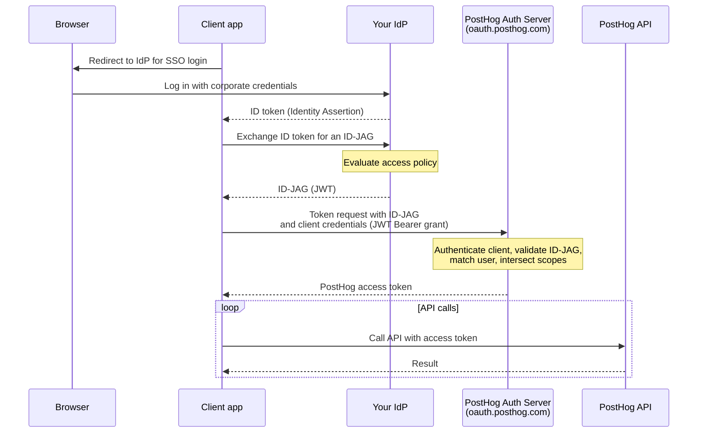

import { CalloutBox } from 'components/Docs/CalloutBox'

ID-JAG (Identity Assertion JWT Authorization Grant, also called [XAA](https://xaa.dev)) lets your organization's identity provider (IdP), such as Okta, Microsoft Entra ID, or any OIDC-compliant SSO, grant programmatic access to PostHog. Instead of each user creating a [personal API key](/docs/api#authentication) or running an [OAuth](/docs/api/oauth) flow, your IdP issues an **ID-JAG** that a client exchanges with PostHog for a short-lived access token. You grant, scope, and revoke access centrally in your IdP.

<CalloutBox icon="IconFlask" title="ID-JAG/XAA is in beta" type="action">

ID-JAG/XAA is currently in `beta`. The flow and configuration can change, and the underlying ID-JAG spec is still evolving.

</CalloutBox>

<CalloutBox icon="IconStar" title="Scale and Enterprise add-ons" type="action">

ID-JAG (XAA) is available to organizations on the Scale or Enterprise [platform add-on](/platform-packages). Without one of them, PostHog shows an upgrade prompt in the XAA settings and rejects token requests with `access_denied`.

</CalloutBox>

## Why use it

ID-JAG keeps authorization decisions in your IdP instead of spreading them across personal keys and per-user OAuth grants:

- **No personal API keys to manage:** users authenticate with their existing corporate SSO, and clients get tokens on demand.
- **Centralized policy:** your IdP evaluates its own access policies (group membership, conditional access, etc.) before it issues an ID-JAG.
- **Centralized revocation:** once your IdP stops issuing ID-JAGs for a user, clients can no longer get new access tokens for them.
- **Scoped tokens:** the access token carries only the scopes your IdP granted, intersected with what the client requested.

The most common use is connecting AI agents to the [PostHog MCP server](/docs/model-context-protocol) under central control. See [enterprise-managed authorization](/docs/model-context-protocol/enterprise-managed-authorization) for the MCP-specific setup.

## How it works



When a client presents an ID-JAG, PostHog:

1. Authenticates the client with its client secret or `private_key_jwt` assertion.
2. Finds the XAA configuration whose issuer URL matches the ID-JAG's `iss` and whose verified domains include the user's email domain.
3. Verifies the ID-JAG signature with your IdP's public keys, then checks its claims (see [what PostHog checks](#what-posthog-checks-in-an-id-jag)).
4. Matches the ID-JAG to an active member of the organization that owns the configuration (see [how PostHog matches users](#how-posthog-matches-users)).
5. Issues a short-lived access token for that member.

## Requirements

- The **Scale or Enterprise platform add-on** on your PostHog organization.
- A **verified domain** in PostHog for the email domain your users sign in with.
- An **IdP that can issue ID-JAGs** and publishes an OIDC discovery document or a JWKS endpoint that PostHog can reach over the internet.
- A **client registered with PostHog** that can authenticate with a client secret or `private_key_jwt`. Your IdP must put that client's PostHog client ID in the ID-JAG's `client_id` claim.

## Setup

### 1. Verify your domain in PostHog

Go to [**Organization settings → Authentication**](https://app.posthog.com/settings/organization-authentication) and add and verify the domain your users authenticate with (e.g. `example.com`) under **Authentication domains**. See the [SSO docs](/docs/settings/authentication/sso) for domain verification steps.

PostHog only accepts ID-JAGs for users whose email domain is a verified domain of the XAA configuration.

### 2. Configure the trusted IdP

On the same settings page, find **XAA authentication** and click **Configure**. You need to be an organization admin. Fill in:

| Field | Required | Description |
| --- | --- | --- |
| **Identity provider issuer URL** | Yes | Your IdP's issuer URL, e.g. `https://idp.example.com`. It must match the `iss` claim on the ID-JAGs your IdP issues. A trailing slash makes no difference. |
| **JWKS URL (optional)** | No | Where PostHog fetches your IdP's public keys. Leave it empty to use OIDC discovery at `{issuer}/.well-known/openid-configuration`. |
| **Allowed client IDs (optional)** | No | The `client_id` values PostHog accepts from this IdP. Leave it empty to accept any registered client. |

Under **Domains**, choose **All domains** to cover every verified domain in your organization, or **Selected domains** to pick specific ones. Then click **Save configuration**.

PostHog rejects issuer and JWKS URLs that point at internal, loopback, or cloud metadata addresses. Use one XAA configuration per issuer and domain. If two configurations match the same issuer and email domain, PostHog rejects the ID-JAG.

### 3. Register the client

The app or agent that exchanges ID-JAGs must authenticate to PostHog as an OAuth client. It can be:

- An [OAuth app](/docs/api/oauth) registered with PostHog that authenticates with its client secret.
- A client that identifies itself with a Client ID Metadata Document (a URL as its client ID) and authenticates with `private_key_jwt`, using a key from the JWKS its document publishes.

Configure your IdP so the ID-JAG's `client_id` claim is the client ID that client uses with PostHog. PostHog rejects an ID-JAG whose `client_id` differs from the client that presents it.

### 4. Grant the required scopes in your IdP

Configure your IdP to include the scopes each integration needs when it issues ID-JAGs. At minimum, all tokens need `user:read`. For the [MCP server](/docs/model-context-protocol/enterprise-managed-authorization), also include `organization:read` and `project:read`. Add any additional [API scopes](/docs/api/personal-api-keys) for what you want to do (for example, `feature_flag:write` to manage flags).

PostHog issues the access token with the **intersection** of the scopes your IdP granted and the scopes the client requested:

- If the client sends no `scope`, the token gets every scope the ID-JAG grants.
- PostHog ignores scopes it doesn't know.
- If the intersection is empty, PostHog still issues a token, and API requests with it fail with `403 insufficient_scope`.

## What PostHog checks in an ID-JAG

| Part | Requirement |
| --- | --- |
| Header `typ` | `oauth-id-jag+jwt` |
| Signature | RS256, RS384, RS512, PS256, PS384, PS512, ES256, ES384, or ES512, with a key from your IdP's JWKS |
| `iss` | Matches the issuer URL of the XAA configuration |
| `aud` | The PostHog authorization server the client uses: `https://oauth.posthog.com` on Cloud, or `https://us.posthog.com` / `https://eu.posthog.com` when the client calls a region directly. On self-hosted, your instance URL. |
| `resource` | The PostHog resource the token is for: `https://us.posthog.com` or `https://eu.posthog.com` for the API, or `https://mcp.posthog.com/mcp` for the MCP server. On self-hosted, your instance URL. |
| `client_id` | The client ID of the client that presents the ID-JAG |
| `sub` | A stable identifier for the user at your IdP |
| `email` | The user's email address. If it's missing, `sub` must be the email address. If `email_verified` is present, it must not be `false`. |
| `iat`, `exp` | The ID-JAG must be valid at most 10 minutes. PostHog allows 30 seconds of clock skew. |
| `jti` | A unique ID. Each ID-JAG works once. |
| `scope` | Optional. Space-separated PostHog scopes. |
| `tenant` | Optional. Set it when your IdP issues ID-JAGs for several tenants under one issuer. |

## How PostHog matches users

PostHog does not create users from ID-JAGs. Each user must already be an active member of the organization that owns the XAA configuration. Use [SCIM](/docs/settings/authentication/scim) or SSO to provision them.

- The first time PostHog sees a user's IdP subject, it matches the `email` claim to an organization member. PostHog then links that subject (issuer, tenant, and `sub`) to the member.
- Later ID-JAGs for that subject resolve to the same member, even if the email address changes at your IdP or in PostHog.
- If a member is already linked to a different subject from the same IdP, PostHog rejects the ID-JAG. This stops an email address that your IdP reassigns from reaching the previous owner's account.

## Exchanging an ID-JAG for an access token

Clients exchange an ID-JAG at PostHog's OAuth token endpoint using the [RFC 7523](https://www.rfc-editor.org/rfc/rfc7523) JWT Bearer grant:

- **Cloud:** `https://oauth.posthog.com/oauth/token/`. It routes the request to your organization's region.
- **Self-hosted:** `{your-instance-url}/oauth/token/`

The request must include client authentication. With a client secret:

```bash
curl -X POST https://oauth.posthog.com/oauth/token/ \
  -d grant_type=urn:ietf:params:oauth:grant-type:jwt-bearer \
  -d assertion=<the ID-JAG JWT from your IdP> \
  -d client_id=<your PostHog client ID> \
  -d client_secret=<your client secret> \
  -d scope="user:read organization:read project:read"
```

With `private_key_jwt`, replace `client_secret` with `client_assertion_type=urn:ietf:params:oauth:client-assertion-type:jwt-bearer` and `client_assertion=<a JWT signed with your client's key>`.

A successful response returns a short-lived access token:

```json
{
  "access_token": "...",
  "token_type": "Bearer",
  "expires_in": 7200,
  "scope": "user:read organization:read project:read"
}
```

Use it as a bearer token on API requests to your organization's region (`https://us.posthog.com` or `https://eu.posthog.com`): `Authorization: Bearer <access_token>`.

Most enterprise MCP clients perform this exchange automatically, so you usually don't call the token endpoint by hand. See [enterprise-managed authorization](/docs/model-context-protocol/enterprise-managed-authorization) for the MCP flow.

## Tokens

The access token PostHog issues from a valid ID-JAG is:

- **Short-lived:** 2 hours by default. The client repeats the ID-JAG exchange to get a fresh token. There is no refresh token.
- **Bound to the user:** requests act as the matched member, with that member's permissions, limited to the granted scopes.
- **Organization-scoped:** bound to the organization that owns the XAA configuration.
- **Audience-restricted:** its `aud` is the ID-JAG's `resource`, and PostHog accepts it only for its own resources.
- **Checked on every request:** PostHog confirms on each request that the user is still an active member and that the organization still has the Scale or Enterprise add-on.

## Revoking access

- **At your IdP:** once your IdP stops issuing ID-JAGs for a user, the client can no longer get new access tokens. Existing tokens expire within the token lifetime.
- **In PostHog:** removing the user from the organization, or deactivating them, stops their tokens working on the next request.
- **The whole integration:** deleting the XAA configuration stops new exchanges. Tokens already issued stay valid until they expire.

## Troubleshooting

The token endpoint returns standard OAuth errors ([RFC 6749 §5.2](https://www.rfc-editor.org/rfc/rfc6749#section-5.2)). Common ones:

| Error | What it means |
| --- | --- |
| `invalid_request` (`assertion is required`) | The request has no `assertion` parameter. |
| `invalid_client` | Client authentication failed: the client ID, secret, or `private_key_jwt` assertion is missing or wrong. It also appears when the ID-JAG's `client_id` isn't in the configuration's allowed client IDs. |
| `invalid_grant` (`ID-JAG could not be verified`) | No XAA configuration matches the ID-JAG's issuer and email domain, or more than one does. It also covers an `iss` that doesn't match after signature verification, an `email_verified` of `false`, and a member already linked to a different IdP subject. The message is intentionally generic, so check your XAA configuration and IdP claims. |
| `invalid_grant` (`ID-JAG sub is not an active member…`) | The email doesn't match an active member of the organization that owns the XAA configuration. |
| `invalid_grant` (`ID-JAG client_id doesn't match the authenticating client`) | The ID-JAG's `client_id` differs from the client that sent the request. |
| `invalid_grant` (`ID-JAG has expired` / `is not yet valid`) | The assertion expired, or the clocks of your IdP and PostHog differ by more than 30 seconds. |
| `invalid_grant` (`ID-JAG lifetime exceeds 600 seconds`) | `exp` is more than 10 minutes after `iat`. |
| `invalid_grant` (`ID-JAG assertion has already been used`) | The client sent an ID-JAG with a `jti` PostHog already accepted. Request a new ID-JAG from your IdP. |
| `invalid_grant` (`ID-JAG is missing required claim…`) | A required claim, such as `jti` or `client_id`, is missing. |
| `invalid_target` | The `resource` claim isn't one of the PostHog resources listed under [what PostHog checks](#what-posthog-checks-in-an-id-jag). |
| `access_denied` | The organization doesn't have the Scale or Enterprise add-on. |
| `insufficient_scope` (from the API) | The granted scopes don't cover the request. Add the missing scopes in your IdP. |

## Further reading

- [Enterprise-managed authorization for MCP](/docs/model-context-protocol/enterprise-managed-authorization)
- [ID-JAG / XAA specification](https://xaa.dev)
- [SSO](/docs/settings/authentication/sso)
- [OAuth integration](/docs/api/oauth)
- [API authentication and scopes](/docs/api#authentication)
