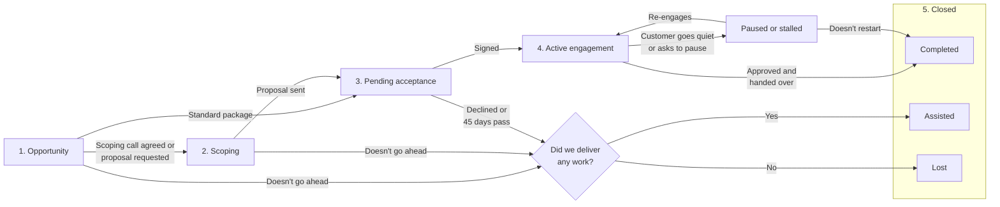

FDE engagements are short-term projects with a tight scope. We scope the problem, design the solution, and ship something production-ready in the customer's environment. Every engagement moves through the stages on this page.

Three principles apply at every stage:

- **Keep discovering.** The problem the customer describes first is rarely the whole problem. Keep asking why at every stage, not only during scoping. See [scoping engagements](/handbook/forward-deployed-engineering/how-we-work#scoping-engagements).
- **The account owner owns the commercial relationship.** The TAE, TAM, or CSM drives pricing, contracts, and renewals. We own the technical outcome. See [working with sales and CS](/handbook/forward-deployed-engineering/working-with-sales-and-cs).
- **Be specific about next steps.** After every conversation with the customer or our internal teams, agree a next step, an owner, and a date. Always recommend the next step yourself: "at this point, the usual next step is for us to do X." If there's no next step, the engagement is closed.

## Stages

1. Opportunity
2. Scoping
3. Pending acceptance
4. Active engagement
5. Closed: completed, assisted, or lost

An active engagement can also be [paused or stalled](#paused-or-stalled).

### 1. Opportunity

An opportunity is a chance for FDE to help a customer in a way that grows revenue or protects the revenue we already have. Opportunities come from two places:

- **Inbound.** A TAE, TAM, or CSM brings a customer to us, following [how to get an FDE involved](/handbook/forward-deployed-engineering/how-to-get-fde-involved).
- **Outbound.** An FDE finds a customer we could help, for example through a support thread, their usage data, or a problem we've already solved for another customer. Talk to the account owner before you contact the customer.

At this stage, we qualify the opportunity. Answer these questions:

- **Is there a real problem?** What's the pain, and what measurable outcome would solving it produce?
- **What revenue is at stake?** New business, expansion, or retention, and roughly how much.
- **Can the customer self-serve?** If the [wizard audit, PostHog skills, or PostHog AI](/handbook/forward-deployed-engineering/how-to-get-fde-involved#first-try-to-self-serve) solve it, point them there instead.
- **Does it fit a standard package?** If it fits [PostHog Foundations 0-1 or Managed Migrations](/handbook/forward-deployed-engineering/how-to-get-fde-involved#self-serve-and-price-our-standard-packages), the account owner can price it directly and the engagement goes straight to pending acceptance.
- **Does the customer want our help?** A problem we can see isn't enough. The customer has to want help to fix it.

Once the customer agrees to a scoping call, or asks an FDE for a formal proposal, the opportunity moves to **scoping**.

### 2. Scoping

The opportunity is qualified, and the customer is open to an engagement. Now we work out exactly what needs to be delivered for the engagement.

- Run discovery with the customer and find out what's really blocking them.
- Confirm what access we'd get: codebase, data, and PostHog project.
- Classify the engagement, estimate the effort, and price it per milestone. See [what it costs](/handbook/forward-deployed-engineering/how-we-work#what-it-costs).
- Write a short proposal with the measurable outcome, the milestones, a rough timeline, the price, and a shared definition of "done." Scope small; it's cheaper to expand a tight scope than to unwind a loose one.

Scoping is free, so time-box it. If scoping turns into real work, such as an audit or a problem analysis we hand to the customer, record it. This work still counts if the engagement doesn't go ahead (see [closed as assisted](#assisted)).

Once the a formal FDE engagement proposal has been sent to a customer, the engagement moves to **pending acceptance**.

### 3. Pending acceptance

The customer has the proposal, and we're waiting for a signature.

- Every proposal has an acceptance deadline of 45 days from the date we send it. Put the deadline in the proposal, and tell the customer about it when you send it.
- Answer the customer's technical questions, and update the proposal if the scope changes.
- Pencil in a kickoff date and flag it to the wider FDE team, so we can plan capacity.

Once the customer signs, the engagement moves to **active engagement**. If they decline, or the 45 days pass without a signature, close it as [assisted](#assisted) or [lost](#lost), depending on whether we delivered any work. If the customer comes back later, start again from scoping, because the scope and our capacity have probably changed.

### 4. Active engagement

The customer has signed, and the engagement is in flight.

- **Kick off.** Confirm the outcome and definition of "done," get access, and agree a named owner on the customer side.
- **Deliver.** Follow the [delivery](/handbook/forward-deployed-engineering/working-with-customers#delivery) and [rhythm](/handbook/forward-deployed-engineering/working-with-customers#rhythms) guidance: a weekly sync, a weekly async update, and replies within a business day.
- **Add scope through the engagement.** If the customer wants more work after the engagement starts, add it to this engagement instead of opening a new one. Added scope is a new quote, not an informal extension: scope it, price it per milestone, and get the customer's sign-off before we start it. See [what it costs](/handbook/forward-deployed-engineering/how-we-work#what-it-costs).
- **Hand over.** Complete the [handover](/handbook/forward-deployed-engineering/working-with-customers#handover) and give the relationship back to the account owner.

Once the customer's named owner approves the final deliverable and the handover is done, the engagement moves to **closed**.

### Paused or stalled

An active engagement can be paused or stalled when:

- the customer stops responding or engaging, or
- the customer explicitly asks to pause.

When this happens:

- Tell the account owner.
- Push for a response. Don't let it drift: follow up regularly, and agree with the customer what has to happen to restart, and by when.
- Write down what we've delivered so far, so we can restart quickly or close cleanly.

Once the customer re-engages, the engagement moves back to **active engagement**. If it stays paused or stalled for more than two months, decide with the team and the account owner whether to close it as [completed](#completed).

### 5. Closed

An engagement closes in one of three ways.

#### Completed

The formal engagement is finished, or a paused or stalled engagement didn't restart.

- Record the outcome we measured against the one we agreed during scoping.
- Capture anything reusable, and send product feedback to the [product engineering teams](/handbook/forward-deployed-engineering/working-with-product-engineering) if not done already.
- Run an internal retro, and document it in the <PrivateLink url="https://github.com/PostHog/fde-vault">fde-vault</PrivateLink>.

##### Retro

Every completed engagement gets an internal retro. The purpose is:

- **Measurable outcome.** Every engagement is tied to a clear outcome that we agreed during scoping, such as a finished migration, data the customer trusts, or higher adoption of a product. The retro checks the results against that outcome. The impact of FDE work often takes weeks or months to show, for example in adoption, usage, or the renewal, so set reminders to check in on the account with the account owner one, two, and three months after the engagement ends.
- **Learning from what went well and what didn't.** Understand why, so we repeat the wins and avoid the same problems on the next engagement.
- **Process improvement.** Find gaps in how we qualify, scope, price, and deliver engagements.
- **Knowledge sharing.** Make sure the whole team benefits from what one FDE learned.
- **Documentation.** Keep a record of each engagement, what we found, and how we resolved it.

The retro covers:

- **How the engagement went.** Did we hit the outcome and timeline price we agreed? What were the wins?
- **Delivery.** What we learned from a project perspective: what worked, what slowed us down, and what we'd do differently.
- **Commercial gaps.** For example, a pricing, packaging, or contract problem we hit.
- **Product gaps.** What gaps we found, and what we did about each one: we shipped a fix, found a workaround, or raised it with the product team.

#### Assisted

The customer never became an active engagement, but we delivered work in an earlier stage, such as an audit or a problem analysis.

- Make sure the customer and the account owner have what we delivered.
- Record why the engagement didn't go ahead.

#### Lost

The formal engagement didn't go ahead, and we didn't deliver any work.

- Record why: for example price, timing, no fit, or the customer self-served.
- Tell the account owner, so they can pick up any follow-up.

A [retro](#retro) on a lost engagement is optional. Consider one when the reason it was lost could teach us something, for example if pricing, scoping, legal, or a product gap blocked the engagement.

At the end of each quarter, we may also run a wider retro across all completed engagements and lost opportunities from that quarter, to help set objectives and improvements for the next one.