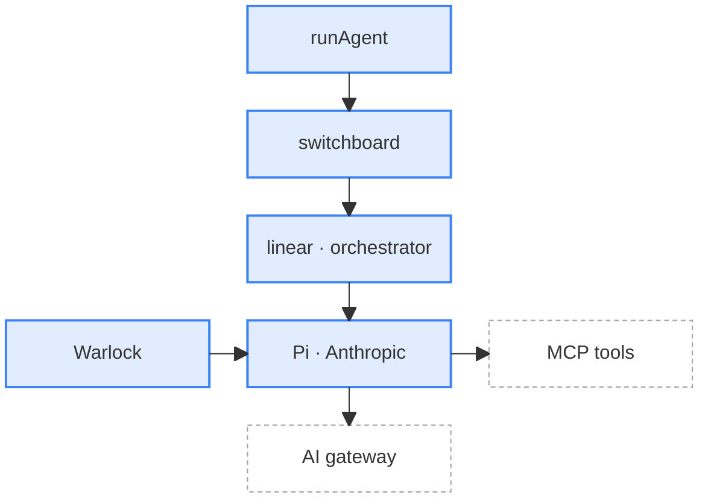

The wizard is built in layers for composability. The context and skills, the agent, the program, and the TUI and CLI are each useful on their own, and composed together for the end experience.

1. **The CLI layer** reads the command and starts a host.
2. **The host layer** shows a run. The TUI draws it in the terminal, and the headless runner logs it.
3. **The program layer** decides what to run, how many agents to spawn, and what each one gets. Its session store holds the state of a run.
4. **The agent layer** runs AI work against the user's code. It has no opinion about what runs, and never sees the UI or the store.

<svg viewBox="-2 -2 688 716" width="100%" role="img" aria-label="Wizard layers: CLI, hosts, programs, agent, harnesses">
<defs><marker id="wizard-arch-arrow" viewBox="0 0 10 10" refX="9" refY="5" markerWidth="7" markerHeight="7" orient="auto-start-reverse"><path d="M 0 0 L 10 5 L 0 10 z" fill="currentColor" fillOpacity="0.7" /></marker></defs>
<rect x="0" y="0" width="684" height="26" rx="3" fill="rgba(156,163,175,0.25)" stroke="none" />
<text x="342.0" y="13.0" textAnchor="middle" dominantBaseline="central" fill="currentColor" fontSize="12">src/cli</text>
<rect x="0" y="56" width="328" height="36" rx="3" fill="rgba(156,163,175,0.14)" stroke="#9ca3af" strokeWidth="2" />
<text x="164.0" y="74.0" textAnchor="middle" dominantBaseline="central" fill="currentColor" fontSize="12" fontFamily="ui-monospace, monospace">runCli</text>
<rect x="0" y="122" width="684" height="26" rx="3" fill="rgba(168,85,247,0.25)" stroke="none" />
<text x="342.0" y="135.0" textAnchor="middle" dominantBaseline="central" fill="currentColor" fontSize="12">src/tui · src/headless</text>
<rect x="0" y="178" width="150" height="36" rx="3" fill="rgba(168,85,247,0.14)" stroke="#a855f7" strokeWidth="2" />
<text x="75.0" y="196.0" textAnchor="middle" dominantBaseline="central" fill="currentColor" fontSize="12" fontFamily="ui-monospace, monospace">runTui</text>
<rect x="178" y="178" width="150" height="36" rx="3" fill="rgba(168,85,247,0.14)" stroke="#a855f7" strokeWidth="2" />
<text x="253.0" y="196.0" textAnchor="middle" dominantBaseline="central" fill="currentColor" fontSize="12" fontFamily="ui-monospace, monospace">runHeadless</text>
<rect x="356" y="178" width="150" height="36" rx="3" fill="rgba(168,85,247,0.14)" stroke="#a855f7" strokeWidth="2" />
<text x="431.0" y="196.0" textAnchor="middle" dominantBaseline="central" fill="currentColor" fontSize="12" fontFamily="ui-monospace, monospace">screens · logs</text>
<rect x="534" y="178" width="150" height="36" rx="3" fill="rgba(168,85,247,0.14)" stroke="#a855f7" strokeWidth="2" />
<text x="609.0" y="196.0" textAnchor="middle" dominantBaseline="central" fill="currentColor" fontSize="12" fontFamily="ui-monospace, monospace">WizardAsk</text>
<rect x="0" y="244" width="684" height="26" rx="3" fill="rgba(34,197,94,0.25)" stroke="none" />
<text x="342.0" y="257.0" textAnchor="middle" dominantBaseline="central" fill="currentColor" fontSize="12">src/programs</text>
<rect x="0" y="300" width="328" height="36" rx="3" fill="rgba(34,197,94,0.14)" stroke="#22c55e" strokeWidth="2" />
<text x="164.0" y="318.0" textAnchor="middle" dominantBaseline="central" fill="currentColor" fontSize="12" fontFamily="ui-monospace, monospace">runProgram</text>
<rect x="356" y="300" width="150" height="36" rx="3" fill="rgba(34,197,94,0.14)" stroke="#22c55e" strokeWidth="2" />
<text x="431.0" y="318.0" textAnchor="middle" dominantBaseline="central" fill="currentColor" fontSize="12" fontFamily="ui-monospace, monospace">SessionStore</text>
<rect x="0" y="366" width="684" height="26" rx="3" fill="rgba(59,130,246,0.25)" stroke="none" />
<text x="342.0" y="379.0" textAnchor="middle" dominantBaseline="central" fill="currentColor" fontSize="12">src/agent</text>
<rect x="0" y="422" width="328" height="36" rx="3" fill="rgba(59,130,246,0.14)" stroke="#3b82f6" strokeWidth="2" />
<text x="164.0" y="440.0" textAnchor="middle" dominantBaseline="central" fill="currentColor" fontSize="12" fontFamily="ui-monospace, monospace">runAgent</text>
<rect x="356" y="422" width="150" height="36" rx="3" fill="rgba(59,130,246,0.14)" stroke="#3b82f6" strokeWidth="2" />
<text x="431.0" y="440.0" textAnchor="middle" dominantBaseline="central" fill="currentColor" fontSize="12" fontFamily="ui-monospace, monospace">AgentProgress</text>
<rect x="534" y="422" width="150" height="36" rx="3" fill="rgba(59,130,246,0.14)" stroke="#3b82f6" strokeWidth="2" />
<text x="609.0" y="440.0" textAnchor="middle" dominantBaseline="central" fill="currentColor" fontSize="12" fontFamily="ui-monospace, monospace">interaction.ask</text>
<rect x="0" y="488" width="328" height="36" rx="3" fill="rgba(59,130,246,0.14)" stroke="#3b82f6" strokeWidth="2" />
<text x="164.0" y="506.0" textAnchor="middle" dominantBaseline="central" fill="currentColor" fontSize="12" fontFamily="ui-monospace, monospace">switchboard</text>
<rect x="0" y="554" width="150" height="36" rx="3" fill="rgba(59,130,246,0.14)" stroke="#3b82f6" strokeWidth="2" />
<text x="75.0" y="572.0" textAnchor="middle" dominantBaseline="central" fill="currentColor" fontSize="12" fontFamily="ui-monospace, monospace">Pi harness</text>
<rect x="178" y="554" width="150" height="36" rx="3" fill="rgba(59,130,246,0.14)" stroke="#3b82f6" strokeWidth="2" />
<text x="253.0" y="572.0" textAnchor="middle" dominantBaseline="central" fill="currentColor" fontSize="12" fontFamily="ui-monospace, monospace">Anthropic harness</text>
<rect x="0" y="620" width="328" height="36" rx="3" fill="none" stroke="#9ca3af" strokeWidth="1.5" strokeDasharray="4 3" />
<text x="164.0" y="638.0" textAnchor="middle" dominantBaseline="central" fill="currentColor" fontSize="12" fontFamily="ui-monospace, monospace">gateway · MCP · skills</text>
<rect x="0" y="686" width="684" height="26" rx="3" fill="rgba(156,163,175,0.25)" stroke="#9ca3af" strokeDasharray="4 3" />
<text x="342.0" y="699.0" textAnchor="middle" dominantBaseline="central" fill="currentColor" fontSize="12">src/shared · src/env</text>
<path d="M 164.0 92 L 164.0 135.0 L 75.0 135.0 L 75.0 176" fill="none" stroke="currentColor" strokeOpacity="0.7" strokeWidth="1.5" markerEnd="url(#wizard-arch-arrow)" />
<path d="M 164.0 92 L 164.0 135.0 L 253.0 135.0 L 253.0 176" fill="none" stroke="currentColor" strokeOpacity="0.7" strokeWidth="1.5" markerEnd="url(#wizard-arch-arrow)" />
<path d="M 75.0 214 L 75.0 257.0 L 164.0 257.0 L 164.0 298" fill="none" stroke="currentColor" strokeOpacity="0.7" strokeWidth="1.5" markerEnd="url(#wizard-arch-arrow)" />
<path d="M 253.0 214 L 253.0 257.0 L 164.0 257.0 L 164.0 298" fill="none" stroke="currentColor" strokeOpacity="0.7" strokeWidth="1.5" markerEnd="url(#wizard-arch-arrow)" />
<path d="M 164.0 336 L 164.0 420" fill="none" stroke="currentColor" strokeOpacity="0.7" strokeWidth="1.5" markerEnd="url(#wizard-arch-arrow)" />
<path d="M 164.0 458 L 164.0 486" fill="none" stroke="currentColor" strokeOpacity="0.7" strokeWidth="1.5" markerEnd="url(#wizard-arch-arrow)" />
<path d="M 164.0 524 L 164.0 539.0 L 75.0 539.0 L 75.0 552" fill="none" stroke="currentColor" strokeOpacity="0.7" strokeWidth="1.5" markerEnd="url(#wizard-arch-arrow)" />
<path d="M 164.0 524 L 164.0 539.0 L 253.0 539.0 L 253.0 552" fill="none" stroke="currentColor" strokeOpacity="0.7" strokeWidth="1.5" markerEnd="url(#wizard-arch-arrow)" />
<path d="M 75.0 590 L 75.0 605.0 L 164.0 605.0 L 164.0 618" fill="none" stroke="currentColor" strokeOpacity="0.7" strokeWidth="1.5" markerEnd="url(#wizard-arch-arrow)" />
<path d="M 253.0 590 L 253.0 605.0 L 164.0 605.0 L 164.0 618" fill="none" stroke="currentColor" strokeOpacity="0.7" strokeWidth="1.5" markerEnd="url(#wizard-arch-arrow)" />
<path d="M 328 440.0 L 354 440.0" fill="none" stroke="currentColor" strokeOpacity="0.7" strokeWidth="1.5" strokeDasharray="3 3" markerEnd="url(#wizard-arch-arrow)" />
<path d="M 431.0 422 L 431.0 338" fill="none" stroke="currentColor" strokeOpacity="0.7" strokeWidth="1.5" strokeDasharray="3 3" markerEnd="url(#wizard-arch-arrow)" />
<text x="437.0" y="380.0" dominantBaseline="central" fill="currentColor" fillOpacity="0.7" fontSize="10" fontStyle="italic">optional</text>
<path d="M 431.0 300 L 431.0 216" fill="none" stroke="currentColor" strokeOpacity="0.7" strokeWidth="1.5" markerEnd="url(#wizard-arch-arrow)" />
<path d="M 609.0 422 L 609.0 216" fill="none" stroke="currentColor" strokeOpacity="0.7" strokeWidth="1.5" strokeDasharray="3 3" markerEnd="url(#wizard-arch-arrow)" />
<text x="615.0" y="319.0" dominantBaseline="central" fill="currentColor" fillOpacity="0.7" fontSize="10" fontStyle="italic">optional</text>
</svg>

The two left lanes are the calls going down, one per host. The third lane is progress coming back up into the store, and the right lane is a question for the user coming back up. Both are optional, so they're dotted: `runAgent` only sends progress through `onProgress` and questions through `interaction.ask` when the host passes them in. Each colour is one owner: grey for the CLI, purple for the hosts, green for programs and the store, and blue for the agent. The dashed box is outside the wizard repo: the AI gateway, the PostHog MCP server, and context mill skills. The bottom band is shared code every layer imports.

## The CLI layer

The CLI reads the command and starts the right host. See the [CLI README](https://github.com/PostHog/wizard/blob/main/src/cli/README.md).

## The host layer

A host starts a program and shows the run. You can build a new host without changing any program.

### TUI

The TUI draws the run in the terminal. The screen is derived from the store's state, there's no manual navigation. This TUI is built with the Ink.js library.

See the [TUI README](https://github.com/PostHog/wizard/blob/main/src/tui/README.md) for details.

### Headless runner

The headless runner logs the run instead of drawing it. CI, the workbench, benchmarks, and cloud runs use it.

See the [headless README](https://github.com/PostHog/wizard/blob/main/src/headless/README.md) for details.

## The program layer

A program is a job with a purpose, like "set up error tracking". The program decides everything the agent doesn't:

- How many agents to spawn, and in what order.
- What each agent does, and when it's done.
- What each agent gets to succeed: extra tools, extra MCP tools, and skills.

Programs can't import each other, so a product team can own its program without touching anyone else's. You can also run a program from code. See the [programs README](https://github.com/PostHog/wizard/blob/main/src/programs/README.md).

### Session store

The session store holds the state of one run. Programs write to it, and hosts read from it. It also streams that state into the PostHog app. See the [programs README](https://github.com/PostHog/wizard/blob/main/src/programs/README.md#session-store-and-task-streams).

### Login

The user logs in once with OAuth, or CI uses an API key. A user with no PostHog account can sign up from the wizard. See the [programs README](https://github.com/PostHog/wizard/blob/main/src/programs/README.md#login-and-signup).

## The agent layer

The agent runs one job and has no opinion about what runs. You can run it on its own from code. See the [agent README](https://github.com/PostHog/wizard/blob/main/src/agent/README.md).

- **Switchboard.** Picks the route.
- **Sequence.** Linear runs one conversation. Orchestrator runs a planner and then a queue of tasks.
- **Harness.** Pi or Anthropic. It calls the model through the PostHog AI gateway.
- **Tools.** The harness calls tools on the PostHog MCP server and on the wizard's own tools server.
- **Warlock.** Scans every command the harness runs, and everything it writes and reads.

### Switchboard

The switchboard decides what model runs each task at what effort on which SDK. A developer, a feature flag, a skill, or a program can set it. See the [switchboard README](https://github.com/PostHog/wizard/blob/main/src/agent/runner/switchboard/README.md).

### Tools

The agent uses the hosted PostHog MCP server, and the wizard's own tools for the jobs a generic agent gets wrong. See the [agent README](https://github.com/PostHog/wizard/blob/main/src/agent/README.md#tools).

### Skills

Skills come from the latest [context mill](/handbook/wizard-and-docs/context-mill) release, and the wizard installs them into the user's project. See the [shared README](https://github.com/PostHog/wizard/blob/main/src/shared/README.md#skills).

## Cloud runs

The wizard can run in a cloud sandbox from the PostHog app, through the headless runner, with its progress streamed back into PostHog. See the [headless README](https://github.com/PostHog/wizard/blob/main/src/headless/README.md).

## Audits

An audit reads the user's code and their PostHog project, and changes neither. `wizard audit` runs the events audit by default. Each audit subcommand is a [context mill](/handbook/wizard-and-docs/context-mill) skill, for example `wizard audit events` is the `audit-events` skill.

The agent audits the code in place, where the wizard runs. It does not upload or copy the repository. It finds PostHog calls with `Grep`, and subagents `Read` only the files that it needs. The model sees the prompt, the content that the agent reads, and the results of its tool calls, through the PostHog AI gateway.

The events audit uses two sources:

- **The code.** Capture call sites, event names, and properties. Each finding has a `file:line`.
- **The PostHog project.** SQL through the PostHog MCP server, for example which events saved insights use, and how much of the volume is pageviews. These findings come from the project, not from a line of code. If MCP is not available, these checks become suggestions and the audit continues.

The audit is read-only:

- The skill tells the agent not to edit project files or change PostHog. It writes only a Markdown report at the project root, and a checks ledger that it deletes at the end.
- The wizard blocks `Read` and `Grep` on `.env` files.
- Warlock scans the content that the agent reads for prompt injection, and the content that it writes for secrets.

The audit also accepts the headless flag, so it can run as a [cloud run](#cloud-runs) on a copy of the repository instead of on the user's machine.

## Go deeper

- [Layer rules](https://github.com/PostHog/wizard/blob/main/.claude/skills/wizard-development/references/ARCHITECTURE.md)
- [Developer interfaces](https://github.com/PostHog/wizard/blob/main/docs/developer-interfaces.md)
- [Agent README](https://github.com/PostHog/wizard/blob/main/src/agent/README.md)
- [Switchboard](https://github.com/PostHog/wizard/tree/main/src/agent/runner/switchboard)
- [Programs README](https://github.com/PostHog/wizard/blob/main/src/programs/README.md)
