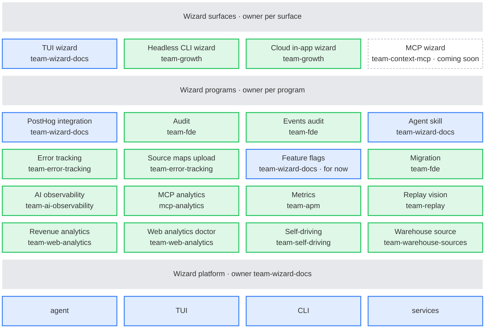

Developers love the [wizard](/docs/ai-engineering/ai-wizard). It started as the fastest way to get a deep, correct PostHog integration, without the hallucinations that come from naive agent-based attempts. It's growing into something more like a forward deployed agent.

```bash
npx -y @posthog/wizard@latest
```

## Why a CLI

Users run the wizard with one `npx` command. This is a big reason it's so portable. Running a command feels better than copying and pasting a prompt into an agent, which is annoying. It works in any terminal, in any project, with no setup.

Because we own the harness, a run is unlikely to be affected by the user's local setup, their model preferences, or whatever else is polluting their agent's context. We can also track the success rate of real runs on the <PrivateLink url="https://us.posthog.com/project/2/dashboard/811546">wizard dashboard</PrivateLink>, and use it to improve the docs.


## What it does today

- Integrates PostHog. It installs the SDK and adds events across many frameworks. See the [public docs](/docs/ai-engineering/ai-wizard).
- Sets up more products, like error tracking, revenue analytics, LLM analytics, and data warehouse sources.
- Audits an existing PostHog integration.
- Migrates a codebase from another analytics tool.
- Adds the PostHog MCP server to the user's editor.

## Roadmap

Things we'd like to work on, in no particular order. For what we're doing this quarter, see the team's [objectives](/teams/wizard-and-docs#objectives).

- **Iterative instrumentation.** Start small and prove value, then give users more when they want it. Useful on day 1, day 10, and day 100.
- **Better handoff to the user's agent.** An opinionated first draft, with enough context for the user's agent to make it theirs.
- **Better handoff to the PostHog app.** Data already flowing when you open PostHog, plus suggested next steps: instrument more, improve data, build dashboards.
- **Tracking new features.** Instrument a newly shipped feature properly.
- **Act as a forward deployed agent.** Help audit, debug, and migrate a customer's setup.
- **Performance.** Every run gets faster and cheaper.

## Who owns what

The wizard has a shared ownership model. The <SmallTeam slug="wizard-and-docs" /> owns the wizard as a harness, and makes it better for everyone. Product teams own the programs for their part of the product.

| Part | Owner | Folder in the wizard |
|---|---|---|
| Wizard core: agent, harness, TUI, and CLI | <SmallTeam slug="wizard-and-docs" /> | `agent`, `tui`, `cli` |
| TUI + npx wizard | <SmallTeam slug="wizard-and-docs" /> | `posthog-integration` |
| Headless CLI wizard | <SmallTeam slug="growth" /> | `headless` |
| Cloud in-app wizard | <SmallTeam slug="growth" /> | `headless` |
| Main integration | <SmallTeam slug="wizard-and-docs" /> | `posthog-integration` |
| Migration | <SmallTeam slug="forward-deployed-engineering" /> | `migration` |
| Audit | <SmallTeam slug="forward-deployed-engineering" /> | `audit` |
| Error tracking | <SmallTeam slug="error-tracking" /> | `error-tracking`, `error-tracking-upload-source-maps` |
| Revenue analytics | <SmallTeam slug="web-analytics" /> | `revenue-analytics` |
| Web analytics doctor | <SmallTeam slug="web-analytics" /> | `web-analytics-doctor` |
| Warehouse sources | <SmallTeam slug="warehouse-sources" /> | `warehouse-source` |
| Self-driving | <SmallTeam slug="self-driving" /> | `self-driving` |
| MCP analytics | <SmallTeam slug="mcp-analytics" /> | `mcp-analytics` |
| Metrics | <SmallTeam slug="apm" /> | `metrics` |
| Replay vision | <SmallTeam slug="replay" /> | `replay-vision` |
| AI observability | <SmallTeam slug="ai-observability" /> | `ai-observability` |
| Run any skill with `wizard skill` | <SmallTeam slug="wizard-and-docs" /> | `agent-skill` |
| Feature flags, for now | <SmallTeam slug="wizard-and-docs" /> | `feature-flags` |



Blue is the <SmallTeam slug="wizard-and-docs" />, green is another team, and dashed is coming soon. Surfaces run programs, and programs run on the platform.

New top-level command names need sign-off from the <SmallTeam slug="wizard-and-docs" />, because a public command is hard to remove.

Programs live in [`src/programs/`](https://github.com/PostHog/wizard/tree/main/src/programs). [`CODEOWNERS`](https://github.com/PostHog/wizard/blob/main/.github/CODEOWNERS) requests reviews from the owner. For who owns each skill, see the [context mill](/handbook/wizard-and-docs/context-mill#who-owns-which-skill).

Ask questions in <PrivateLink url="https://posthog.slack.com/archives/C09GTQY5RLZ">#team-wizard-and-docs</PrivateLink>.

## Go deeper

- [Architecture](/handbook/wizard-and-docs/wizard-architecture)
- [Context mill](/handbook/wizard-and-docs/context-mill)
- [Developing the wizard](/handbook/wizard-and-docs/developing-the-wizard)
- [Extending the wizard](/handbook/wizard-and-docs/extending-the-wizard)
- [Releasing the wizard](/handbook/wizard-and-docs/wizard-releases)
- [Handling wizard incidents](/handbook/wizard-and-docs/wizard-incidents)
