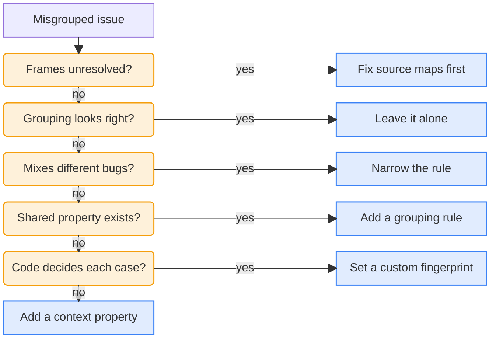

<LeftPage>

<ScreenshotFigure
    n={1}
    product="error_tracking"
    screenshot="grouping-rule"
    caption="The rule editor tests how many exceptions a grouping rule matches before you save it."
/>

</LeftPage>

<RightPage>

# Issue grouping

With readable stack traces, the engineers check how PostHog groups the **Trip details** exceptions.

PostHog groups each exception into an <Term name="issue" /> by the first of these that applies:

1. **A fingerprint the engineers set at capture time.** It wins over everything else, and changing it takes a code deploy.
2. **A grouping rule the engineers defined in PostHog.** It runs at ingestion, so it doesn't need a deploy.
3. **The fingerprint PostHog generates.** PostHog uses it when the engineers have set neither.

## Default grouping

By default, PostHog builds a <Term name="fingerprint" /> for each exception and puts exceptions with the same fingerprint in the same issue.

PostHog builds the fingerprint from the exception type and the frames in its <Term name="stack trace" />. If the exception has no stack trace, PostHog uses the exception message in place of the frames.

In minified code, the fingerprint uses the bundle's frames until PostHog has the bundle's <Term name="source map" />. A new build can change those frames, so a deploy can open a new issue for a bug Twig already has. To prevent it, the engineers [upload Twig's source maps](/learn/error-tracking/pocket-guide/stack-traces#source-map-uploads).

## Custom grouping

The engineers customize grouping when the default splits one bug into many issues, or puts different bugs in one issue:

- **Grouping rules.** The engineers add a rule in [Error Tracking settings](https://app.posthog.com/error_tracking/configuration#selectedSetting=error-tracking-custom-grouping). A rule filters on any event property, such as the exception type or source file, and the editor tests how many exceptions match before saving <SeeFig n={1} />. Rules run in order and the first match wins, so specific rules go first.
- **Custom fingerprints.** The engineers set `$exception_fingerprint` when they capture the exception. It fits when Twig's code has to pick the group for each exception. For autocaptured exceptions, they set it in [`before_send`](/learn/error-tracking/pocket-guide/reduce-noise#filters-in-the-app), a hook that edits events before the SDK sends them.

Both apply at ingestion, so they only change exceptions captured after the engineers add them. To combine issues that already exist, the engineers select them in the issue list and click **Merge**.

## Misgrouped issues

When an issue looks misgrouped, the engineers give their agent the [grouping skill](/learn/error-tracking/agent-prompts-and-mcp#skills). It asks these questions about each issue and stops at the first yes:

It checks Twig's exceptions and code, then lists each issue it changed and which changes need a deploy.

If no property tells the exceptions apart, the skill tags them in Twig's code, like `surface: trip_details` on every exception from **Trip details**. A grouping rule can then match on that tag.

<LessonFooter nextLabel="Reduce noise" nextHref="/learn/error-tracking/pocket-guide/reduce-noise">

[Grouping exceptions into issues](/docs/error-tracking/grouping-issues) · [Fingerprints](/docs/error-tracking/fingerprints)

</LessonFooter>

</RightPage>
