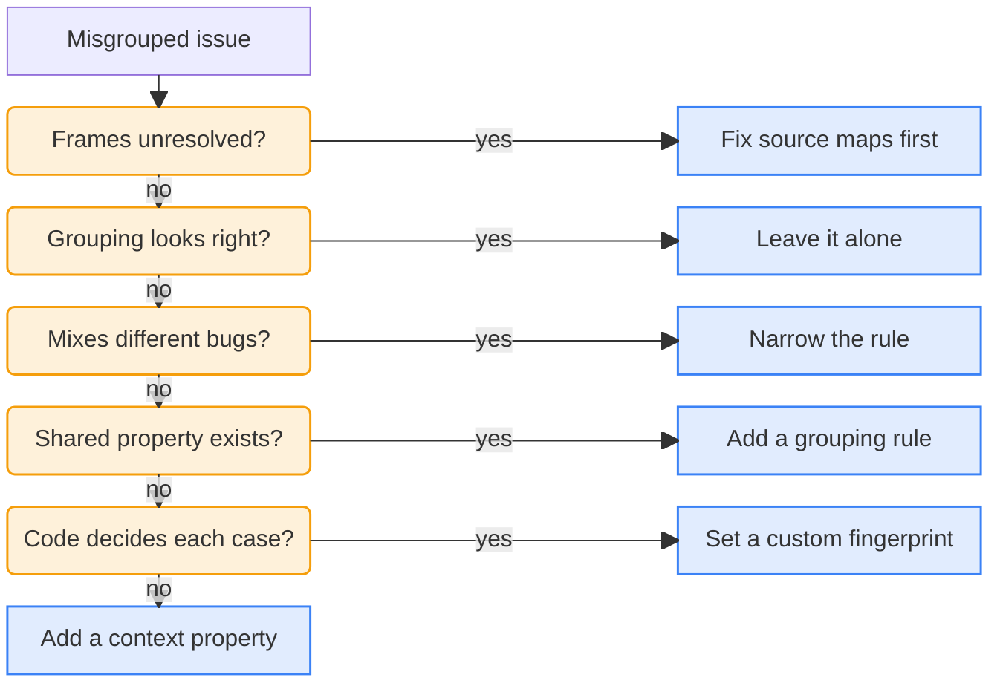

<LeftPage>

<IssueListFigure
    n={1}
    caption="One missing host record opens two issues in Twig's issue list, one for each function that throws."
/>

<StackTraceCompareFigure
    n={2}
    caption="The same error from two places. The Twig frames differ, so the fingerprints differ."
    traces={[
        {
            type: 'HostNotFoundError',
            message: 'Host "colette" not found for booking booking_3',
            frames: [
                {
                    fn: 'readTripHost',
                    source: 'src/trips/trip-details.ts@12:11',
                    inApp: true,
                    fingerprinted: true,
                    marker: {
                        n: 1,
                        label: 'Twig frames',
                        gloss: 'The fingerprint icon marks the frames PostHog fingerprinted: readTripHost and openTripDetails.',
                    },
                },
                {
                    fn: 'openTripDetails',
                    source: 'src/account/AccountPages.tsx@42:18',
                    inApp: true,
                    fingerprinted: true,
                },
                { fn: 'renderWithHooks', source: 'node_modules/react-dom/client.js@5654:24' },
            ],
        },
        {
            type: 'HostNotFoundError',
            message: 'Host "colette" not found for stay stay-03',
            frames: [
                {
                    fn: 'StayPageView',
                    source: 'src/stays/StayPageView.tsx@14:11',
                    inApp: true,
                    fingerprinted: true,
                    marker: {
                        n: 2,
                        label: 'Different Twig frames',
                        gloss: 'Here only StayPageView is fingerprinted, so this fingerprint differs from the other one.',
                    },
                },
                { fn: 'renderWithHooks', source: 'node_modules/react-dom/client.js@5654:24' },
                { fn: 'performUnitOfWork', source: 'node_modules/react-dom/client.js@12561:98' },
            ],
        },
    ]}
/>

<AssignmentRuleFigure
    n={3}
    kind="grouping"
    property="Exception type"
    operator="equals"
    value="HostNotFoundError"
    exceptionCount={1442}
    issueCount={2}
    caption="A grouping rule that puts every HostNotFoundError in one issue. Before saving, the editor tests how many exceptions it would have grouped in the last 7 days."
/>

<FingerprintCaptureFigure
    n={4}
    caption="Twig's capture call for a missing host. The fingerprint includes the host, so each missing host gets its own issue."
/>

<SkillFigure n={5} caption="The skill Twig's engineers use to debug misgrouped issues. Copy it and give it to your agent." />

</LeftPage>

<RightPage>

# Issue grouping

PostHog groups exceptions into <Term name="issue">issues</Term> by their code. Sometimes exceptions that look different in code have the same cause.

When a stay's host record is missing, **Trip details** and the stay page both throw a `HostNotFoundError`, from `readTripHost` and `StayPageView`. PostHog puts these exceptions in two issues <SeeFig n={1} />.

## How PostHog groups

PostHog decides how to group exceptions into issues by going through these rules, in order:

1. **A custom <Term name="fingerprint" /> set in source code.** If that's not set:
2. **A <Term name="grouping rule" /> in PostHog.** If that's not set:
3. **A default fingerprint PostHog generates.**

## Default generated fingerprints

PostHog generates the fingerprint from the exception type and Twig's frames in the <Term name="stack trace" />, or from the message if there's no stack trace.

Both exceptions are a `HostNotFoundError`, but one throws in `readTripHost` and the other in `StayPageView` <SeeFig n={2} />. Different frames make different fingerprints, so PostHog puts them in two issues.

When a <Term name="source map" /> is absent, PostHog groups by the first in-app frame in the minified code instead. Each deploy can minify that frame differently, so the same bug can land in a new issue after every deploy.

## Custom grouping

The engineers want every `HostNotFoundError` in one issue, wherever Twig throws it. They add a grouping rule in [Error Tracking settings](https://app.posthog.com/error_tracking/configuration#selectedSetting=error-tracking-custom-grouping) that matches the exception type <SeeFig n={3} />.

The rule only applies to new exceptions, so the engineers also select the two existing issues in the issue list and click **Merge**.

## Custom fingerprinting

The grouping rule puts every `HostNotFoundError` in one issue. The engineers want one issue per missing host instead, because each host record needs its own fix.

A grouping rule would need a new rule for every host. Twig's code already knows which host is missing, so it's easier to put the host in the fingerprint there <SeeFig n={4} />.

A custom fingerprint wins over the grouping rule. Each missing host now gets its own issue, whether Trip details or the stay page finds it. Like grouping rules, custom fingerprints only apply to new exceptions.

## Misgrouped issues

As software grows and the organization changes, how you think about grouping will change as well.

When issues are misgrouped, Twig's engineers debug like this:

We turned this into a skill for you to debug your misgrouped issues <SeeFig n={5} />.

<LessonFooter nextLabel="Reduce noise" nextHref="/learn/error-tracking/pocket-guide/reduce-noise">

[Grouping exceptions into issues](/docs/error-tracking/grouping-issues) · [Fingerprints](/docs/error-tracking/fingerprints)

</LessonFooter>

</RightPage>
