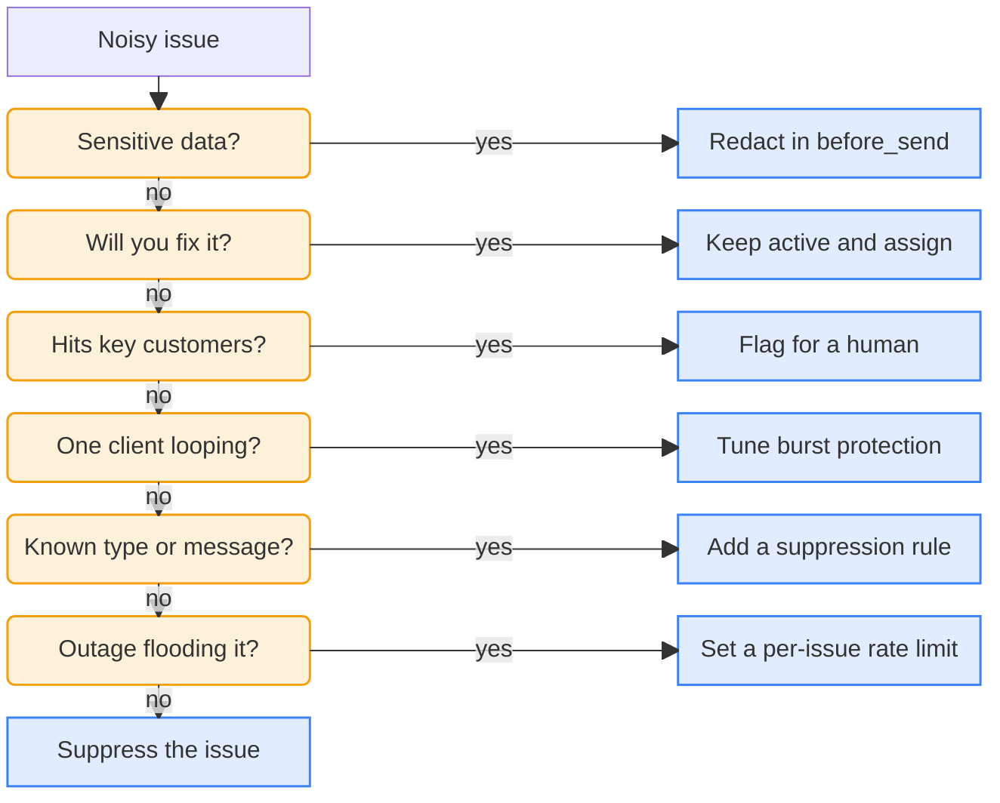

<LeftPage>

<ScreenshotFigure
    n={1}
    product="error_tracking"
    screenshot="suppression-rule"
    caption="This suppression rule drops two exception types from now on."
    annotations={[
        {
            x: 42,
            y: 27,
            title: 'Any or all filters',
            description: 'Any drops an exception that matches at least one filter. All drops it only when every filter matches.',
        },
        {
            x: 74,
            y: 49,
            title: 'Exception type',
            description: 'Rules on the type or message can also run in some SDKs, which drop the exception before sending it.',
        },
        {
            x: 72,
            y: 62,
            title: 'The values to drop',
            description: 'Exceptions with these types are dropped from now on. Exceptions already stored stay.',
        },
    ]}
/>

<SkillFigure n={2} caption="Copy this skill and give it to your agent when exceptions you won't fix crowd your issue list." />

</LeftPage>

<RightPage>

# Keep noise out

You can drop noisy exceptions in your app or at ingestion. PostHog doesn't store or bill dropped exceptions, and you can't recover them.

| Protection | Use it for |
| --- | --- |
| [Filters in your app](#filters-in-your-app) | Dropping exceptions you never want, and redacting data that must not leave your app |
| [Burst protection](#burst-protection) | Stopping one client stuck in a loop from flooding your project |
| [Suppression rules](#suppression-rules) | Dropping noise you'll never fix, like errors from browser extensions |
| [Rate limits](#rate-limits) | Capping volume during an outage, for the whole project or for one issue |

## Filters in your app

The `before_send` hook runs in your app before the SDK sends anything. Return `null` to drop an exception, or edit its properties to redact sensitive data. Nothing you drop here reaches PostHog, so it's the cheapest place to filter.

```js
posthog.init('<ph_project_token>', {
    before_send: (event) => {
        const exception = event.properties.$exception_list?.[0]
        if (exception?.value?.includes('ResizeObserver loop')) {
            return null
        }
        return event
    },
})
```

The web, Node.js, React Native, iOS, Android, Flutter, Kotlin, Python, Ruby, and Roblox SDKs all have this hook, and some name it `beforeSend`. [Suppressing exceptions](/docs/error-tracking/capture#suppressing-exceptions) shows it for web and React Native.

## Burst protection

The  [web](/docs/libraries/js) and  [Node.js](/docs/libraries/node) SDKs cap how many autocaptured exceptions of one type a client sends: 10, then 1 every 10 seconds. It's on by default, so a loop in one browser can't flood your project. Raise the limits if your app throws in legitimate bursts.

Burst protection only runs in those two SDKs, and only in the client. To cap volume from every SDK, use [rate limits](#rate-limits), which PostHog applies at ingestion.

## Suppression rules

A suppression rule drops future exceptions that match its filters, like the exception type or message <SeeFig n={1} />. Use it for noise you can describe, like errors from browser extensions or third-party scripts. Add rules in [Error Tracking settings](https://app.posthog.com/error_tracking/configuration#selectedSetting=error-tracking-suppression-rules). PostHog applies them at ingestion, and some SDKs apply them in the app too.

You can also suppress a single issue, which drops every future exception in it. Each issue has one of three statuses:

- **Active** is the default. The issue needs attention.
- **Resolved** means it's fixed. PostHog keeps the data and reopens the issue if the error comes back.
- **Suppressed** means you won't fix it. PostHog drops its future exceptions. Exceptions it already stored stay.

Leave a bug you plan to fix active, and assign it.

## Rate limits

Rate limits cap how many exceptions PostHog ingests in a window of 15 minutes, 30 minutes, or an hour. A project-wide limit caps your total volume. A per-issue limit gives each issue its own cap, so one noisy issue during an outage can't drown out the rest.

Bypass rules let critical exceptions skip both limits. PostHog still bills the exceptions they let through.

## Noisy issues

Give your agent the skill to find your noisiest issues from the last 7 days and propose a control for each <SeeFig n={2} />. It asks these questions about each issue and stops at the first yes:



It asks for your approval before it changes anything.

<SeeAlso>

See also: [Rate limiting](/docs/error-tracking/rate-limiting)

</SeeAlso>

</RightPage>
