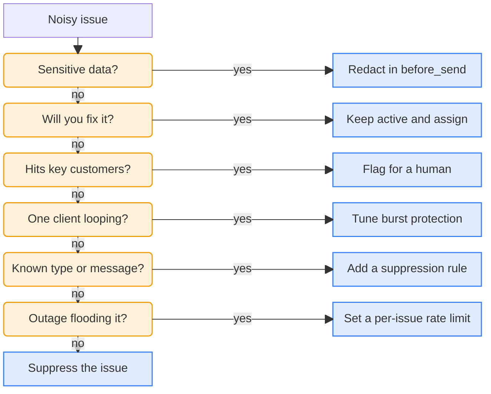

<LeftPage>

<ScreenshotFigure
    n={1}
    product="error_tracking"
    screenshot="suppression-rule"
    caption="This suppression rule drops two exception types from now on."
    annotations={[
        {
            x: 42,
            y: 27,
            title: 'Any or all filters',
            description: 'Any drops an exception that matches at least one filter. All drops it only when every filter matches.',
        },
        {
            x: 74,
            y: 49,
            title: 'Exception type',
            description: 'Rules on the type or message can also run in some SDKs, which drop the exception before sending it.',
        },
        {
            x: 72,
            y: 62,
            title: 'The values to drop',
            description: 'Exceptions with these types are dropped from now on. Exceptions already stored stay.',
        },
    ]}
/>


<SkillFigure n={2} caption="The skill Twig's engineers use to find noisy issues and pick a control for each. Copy it and give it to your agent." />

</LeftPage>

<RightPage>

# Reduce noise

Twig is growing, and the engineers are starting to notice issues they'll never fix, like browser extensions failing or `ResizeObserver loop` errors from the browser.

PostHog bills by events ingested, so these noisy events also cost money.

Here's how Twig's engineers use various tools to silence different types of noisy exceptions:

| Tool | How Twig uses it |
| --- | --- |
| [Production builds only](#skip-local-development-with-production-builds) | Local development never sends exceptions |
| [`before_send`](#drop-browser-errors-with-before_send) | Drops `ResizeObserver loop` errors before they leave the browser |
| [Burst protection](#stop-looping-browsers-with-burst-protection) | Keeps one looping browser from flooding the project |
| [Suppression rules](#drop-extension-errors-with-a-suppression-rule) | Drops errors from browser extensions at ingestion |
| [Rate limits](#cap-outages-with-rate-limits) | Caps volume during an outage |

## Skip local development with production builds

Twig only starts PostHog in production builds. Local development builds don't capture events or exceptions:

```js
if (process.env.NODE_ENV === 'production') {
    posthog.init('<ph_project_token>', { capture_exceptions: true })
}
```

Local development environments are especially noisy, and many of the exceptions that happen in local development don't manifest in production at all.

## Drop browser errors with before_send

The engineers drop the browser's `ResizeObserver loop` errors in Twig with the SDK's `before_send` hook, which runs before the SDK sends anything. It returns `null` to drop an exception, or edits its properties to redact sensitive data:

```js
posthog.init('<ph_project_token>', {
    before_send: (event) => {
        const exception = event.properties.$exception_list?.[0]
        if (exception?.value?.includes('ResizeObserver loop')) {
            return null
        }
        return event
    },
})
```

Nothing dropped here reaches PostHog, so it's the cheapest place to filter.

The  [web](/docs/error-tracking/installation/web),  [Node.js](/docs/error-tracking/installation/node),  [React Native](/docs/error-tracking/installation/react-native),  [iOS](/docs/error-tracking/installation/ios),  [Android](/docs/error-tracking/installation/android),  [Flutter](/docs/error-tracking/installation/flutter),  [Kotlin](/docs/error-tracking/installation/kmp),  [Python](/docs/error-tracking/installation/python),  [Ruby](/docs/error-tracking/installation/ruby), and  [Roblox](/docs/error-tracking/installation/roblox) SDKs all have a similar hook, and some name it `beforeSend`. [Suppressing exceptions](/docs/error-tracking/capture#suppressing-exceptions) shows it for web and React Native.

## Stop looping browsers with burst protection

Burst protection in the  [web](/docs/libraries/js) and  [Node.js](/docs/libraries/node) SDKs keeps a bug that loops in one guest's browser from flooding the project: a client sends 10 autocaptured exceptions of one type, then 1 every 10 seconds. It's on by default.

Burst protection only runs in those two SDKs, in the client. To cap volume from every SDK, the engineers use [rate limits](#cap-outages-with-rate-limits).

## Drop extension errors with a suppression rule

The engineers add a suppression rule in [Error Tracking settings](https://app.posthog.com/error_tracking/configuration#selectedSetting=error-tracking-suppression-rules) for errors from guests' browser extensions. It drops future exceptions that match its filters, like the exception type or message <SeeFig n={1} />. PostHog applies rules at ingestion, and some SDKs apply them in the app too.

## Cap outages with rate limits

Rate limits cap how many exceptions PostHog ingests during an outage, in a window of 15 minutes, 30 minutes, or an hour. The engineers set a per-issue limit, so one noisy issue can't use up the whole project's limit. A project-wide limit caps the project's total volume.

Bypass rules let critical exceptions skip both limits. PostHog still bills the exceptions they let through.

## Triage noisy issues

When an issue gets noisy, Twig's engineers decide what to do with it like this:



We turned this into a skill for you to triage your noisy issues <SeeFig n={2} />. It asks for approval before it changes anything.

<LessonFooter nextLabel="Querying exceptions" nextHref="/learn/error-tracking/pocket-guide/querying-exceptions">

[Rate limiting](/docs/error-tracking/rate-limiting)

</LessonFooter>

</RightPage>
