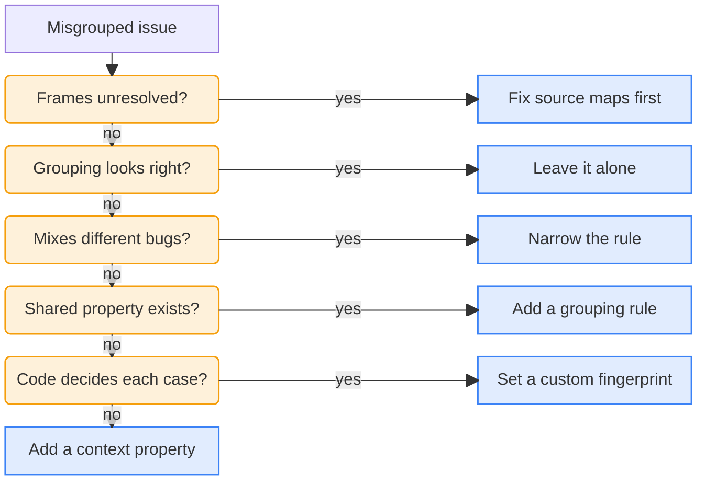

<LeftPage>

<ScreenshotFigure
    n={1}
    product="error_tracking"
    screenshot="grouping-rule"
    caption="The rule editor tests how many exceptions a grouping rule matches before you save it."
/>

<SkillFigure n={2} caption="Copy this skill and give it to your agent when two issues should be one, or one issue holds two bugs." />

</LeftPage>

<RightPage>

# Group exceptions into issues

PostHog groups each exception into an <Term name="issue" /> by the first of these that applies:

1. **A fingerprint you set at capture time.** It wins over everything else, and you need a code deploy to change it.
2. **A grouping rule you defined in PostHog.** It runs at ingestion, so you don't need a deploy.
3. **The fingerprint PostHog generates.** PostHog uses it when you've set neither.

## Default grouping

By default, PostHog builds a <Term name="fingerprint" /> for each exception and puts exceptions with the same fingerprint in the same issue.

PostHog builds the fingerprint from the exception type and the frames in its <Term name="stack trace" />. If the exception has no stack trace, PostHog uses the exception message in place of the frames.

In minified code, the fingerprint uses the bundle's frames until PostHog has the <Term name="source map" /> for that bundle. A new build can change those frames, so after a deploy PostHog can open a new issue for a bug you already have. [Make stack traces readable](/pocket-guides/error-tracking/stack-traces) shows how to give PostHog your source maps.

## Custom grouping

Customize grouping when the default splits one bug into many issues, or puts different bugs in one issue. You have two options:

- **Grouping rules.** Add a rule in [Error Tracking settings](https://app.posthog.com/error_tracking/configuration#selectedSetting=error-tracking-custom-grouping). Filter on any event property, such as the exception type or source file, and test how many exceptions match before you save <SeeFig n={1} />. Rules run in order and the first match wins, so put specific rules first.
- **Custom fingerprints.** Set `$exception_fingerprint` when you capture the exception. Use it when your code has to pick the group for each exception. For autocaptured exceptions, set it in `before_send`.

Both apply at ingestion, so they only change exceptions captured after you add them. To combine issues that already exist, select them in the issue list and click **Merge**.

## Fix misgrouped issues with your agent

The skill asks these questions about each misgrouped issue and stops at the first yes.

Give your agent the skill when an issue looks misgrouped <SeeFig n={2} />. It checks your exceptions and your code, then lists each issue it changed and says which changes need a code deploy.

<SeeAlso>

See also: [Grouping exceptions into issues](/docs/error-tracking/grouping-issues) · [Fingerprints](/docs/error-tracking/fingerprints)

</SeeAlso>

</RightPage>
